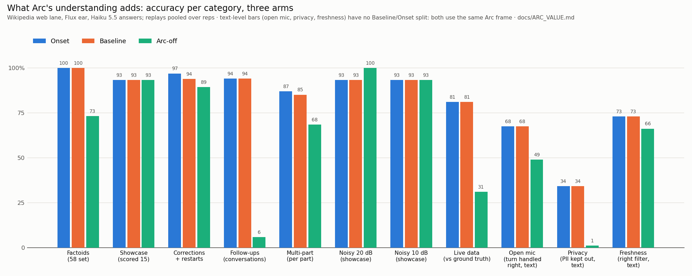

# What Arc's understanding adds (beyond speed)

Onset's A/Bs so far compared Onset with **Baseline**. Both arms use the same Arc frame, and Baseline only waits for the
endpoint before it searches. So those A/Bs measure timing, not Arc. This report adds a third arm, **Arc-off ("plain
voice search")**, which is what a typical voice assistant does:

- The raw final transcript, lowercased and stripped of punctuation, is the web query.
- None of the tagger read-out is used: no correction handling or repair merging, no entity carry or memory (the answer
  model gets no previous turn), no router lanes or cards, no PII redaction, no topic or freshness params, no open-mic
  gate, no planner, no local-corpus routing.
- The ear (Deepgram Flux), web lane (Wikipedia), reranker (EmbeddingGemma), answer model (Haiku 5.5) and answer prompt
  are the same. The only prompt difference is that the frame hints (conversion note, carried referent, part plan) are
  missing.

Code: `Session(mode="plain")`, or `ARC_OFF=1` for every session. See `frame.plain`, `Session._answer_plain`, and the
`plain-search` path in `Speculator.finalize`. Tests are in `tests/test_arc_off.py` (13). Nothing changes for the other
two modes: the full suite passes, 388 tests (on main with feat/cost + Keystone).

## Headline

Accuracy comes first. Each replay row pools every run of every question across reps.

| category | n (q × reps) | Onset | Baseline | Arc-off | Onset, parity (feat/gaps, 1 rep) | what Arc did |
|---|---|---|---|---|---|---|
| Plain factoids, 58 set | 58 × 2 | **116/116** | 116/116 | 85/116 (73%) | 56/58 (local 20/20) | All of the gap is the 20 local-corpus questions (9/40 Arc-off). The 38 web factoids: 76/76 in all three arms |
| Showcase (scored) | 15 × 2 | 28/30 | 28/30 | 28/30 | 13/15 | none on accuracy. Arc-off answered 4 split turns twice (vs 2) |
| Self-corrections + restarts | 33 × 2 | **64/66 (97%)** | 62/66 | 59/66 (89%) | **65/66** (×2 reps), mentions wrong 11 | the corrected-away answer is mentioned in 12 vs 24 answers. Arc-off: 4 wasted answers |
| Follow-ups (21 conversations) | 34 follow-up turns | **32/34 (94%)** | 32/34 | **2/34 (6%)** | 31/34 | pronouns, ellipsis and user facts resolved in place (memory) |
| Multi-part | 26 × 1 | **47/54 parts (.87)**, 22/26 whole | 46/54, 20/26 | 37/54 (.69), 13/26 | 44/54 (.81), 16/26 (speed on the same branch: 47/54, 20/26) | the planner searches each part |
| Open mic (text, Flux turns) | 521 turns | 67.6% of turns handled right | (same frame) | 49.1% | v2 gate: **86.8%** (non-requests answered 22%, requests missed 4.7%) | holds 45% of non-requests, misses 9% of requests (v1) |
| Privacy (text, PII in a search string) | 671 PII turns | 65.7% leak (54.4% leak most of it) | (same frame) | 98.8% leak | 63.0% (45.3% most); birth-year words 65/69 → 6/69 | redaction catches about a third |
| Freshness (text, gold labels) | 424 | 73.1% right filter, **21% recall** on time-sensitive | (same frame) | 66.3%, 0% recall | (unchanged) | weak: only news / result / finance shapes get a filter |
| Noisy speech 20 dB | 15 × 1 | 14/15 | 14/15 | 15/15 | 14/15 | none (Flux heard every question) |
| Noisy speech 10 dB | 15 × 1 | 14/15 | 14/15 | 14/15 | 14/15 | none |
| Live data vs ground truth | 16 × 1 | **13/16** | 13/16 | 5/16 | **16/16** (15 cards) | cards: weather 3/5 vs 0/5, FX 4/4 vs 1/4, clock 2/3 vs 0/3, units 4/4 vs 4/4 |

Then latency and cost, from the same runs. "paid/q" counts web calls that reach the paid backend, i.e. calls that would
be Tavily credits; the Wikipedia lane is free, and the meter prices them as Tavily calls. "$/q (est.)" is the cost
meter's estimate: answer-model tokens plus paid calls.

| category | Onset p50 / p90 ms | Baseline p50 / p90 | Arc-off p50 / p90 | paid/q O / B / A | $/q est. O / B / A | parity: p50 / p90, paid/q, $/q |
|---|---|---|---|---|---|---|
| 58 set (load avg ~50) | 5093 / 9385 | 4115 / 6194 | 4274 / 6238 | 0.76 / 0.62 / 0.97 | .0063 / .0052 / .0080 | 1471 / 2281, **0.17**, .0015 |
| Showcase (loaded) | 2843 / 4154 | 3260 / 4234 | 3241 / 4394 | 1.03 / 0.78 / 1.00 | .0085 / .0065 / .0083 | 1172 / 1877, 0.70, .0058 |
| Corrections (loaded) | 3033 / 4918 | 3280 / 4502 | 3156 / 4346 | 1.39 / 0.94 / 0.98 | .0114 / .0076 / .0081 | 2160 / 3119, **0.61**, .0050 |
| Follow-ups (load ~30) | **1438** / 1912 | 2004 / 2478 | 2089 / 2932 | 0.56 / 0.64 / 1.00 | | 1418 / 2048, 0.14 |
| Multi-part (load ~27) | **1616** / 2104 | 2079 / 2586 | 2202 / 2946 | 0.92 / 1.50 / 0.96 | .0074 / .0122 / .0079 | 1724 / 2679, 1.15, .0098 |
| Noisy 20 dB | **1084** / 1924 | 1549 / 2641 | 1907 / 2425 | 1.20 / 0.67 / 1.00 | .0100 / .0055 / .0082 | 1419 / 1725, 0.87, .0071 |
| Noisy 10 dB | **1363** / 2083 | 1912 / 2343 | 1998 / 2360 | 1.13 / 0.67 / 1.00 | .0094 / .0055 / .0082 | 1246 / 2297, 0.93, .0076 |
| Live data | **592** | 920 | 1998 | (cards: 0) | | 685, 0 |

**Latency caveat.** The factoid, showcase and correction replays ran while other agents' training and evals kept the
machine at load average 46-51 (measured 01:30). Absolute ms in those rows are 2-3x the quiet-machine numbers in
PROGRESS.md. On the 58 set, Onset is even slower than Baseline at p50, which is the load (speculation is CPU-bound
there) and not a property of the modes. The multi-part, noisy and live rows ran at load ~27-30, and there the usual
order holds: Onset < Baseline ≈ Arc-off. On latency, Arc-off is a Baseline without the router's free lanes. It is
never faster than Baseline except where Baseline pays for an extra lane (the planner's parts).

Every number traces to `runs/arcvalue/` (git-ignored; see "Files"). The tables come from
`eval/arcvalue/analyze.py` → `runs/arcvalue/summary.json`, plus `textlevel.json` and `live_scored.json`.

### Definitions
- **accuracy**: `run_ab.score`, which requires every expected keyword in the answer. Multi-part counts per part and
  whole question (`eval/multipart/score.py`). Conversations use run_conv's substring scorer. Live data is checked
  against ground truth (§9).
- **harmful**: for corrections, the answer names the corrected-away question's answer ("wrong" keywords in
  `eval/arcvalue/corrections.jsonl`) and not the one that was meant. Elsewhere, a wrong answer stated without a hedge.
  "Mentions wrong" counts any mention of the corrected-away answer, even next to the right one.
- **wasted answers**: more than one answer for one spoken question, i.e. a split turn answered twice.
- **privacy leak**: a gold-hidden word (house number, phone digits, card, e-mail, gov id, birth year, handle) appears in
  a string that leaves the machine for a search. That means the web query, the entity query, the Tavily-shaped query,
  or the free-API args of the router plan. Stopwords and words also said un-hidden elsewhere are ignored.

---

## 1. Plain factoids: Arc adds nothing on the web, and routing on the local corpus
`runs/arcvalue/fact58_r1.json`, `fact58_r2.json`, `showcase_r1.json`, `showcase_r2.json`

| set | Onset | Baseline | Arc-off |
|---|---|---|---|
| 38 web factoids (22 factoid, 8 filler, 8 correction) | 76/76 | 76/76 | **76/76** |
| 20 local-corpus questions (games, hearings, calls, meetings) | 40/40 | 40/40 | 9/40 |
| showcase, 15 scored | 28/30 | 28/30 | 28/30 |

On the web set, the raw sentence on Wikipedia is as good as Arc's content-word query: 76/76 with no misses. The answer
model copes with fillers ("um, I forget, who directed the movie Jaws"). It also copes with the 8 corrections in this set:
Wikipedia returns both entities' pages, and the system prompt tells the model to answer the corrected question. All of
the 58-set gap is local: Arc-off has no `route=local`, so "in the hearing where was the gun found" goes to Wikipedia. That
gap comes from routing, not language understanding. The cue list is text (`frame.LOCAL_CUES`), and a plain assistant
with a local index could match it too.

Examples (first rep; transcripts are what Flux heard):
- local05 "in the hearing where was the gun found". Onset, query `hearing gun found` → "The gun was found in the chair,
  according to counsel at the Supreme Court argument [4]". Arc-off, query = the sentence → "The search returned no
  sources, so I can't tell you … where the gun was found in that hearing."
- local03 "in the call where did they agree to meet halfway on the discount". Onset → "They agreed to meet halfway at
  6%, as the negotiator proposed at 01:32 in the negotiation call". Arc-off → "The sources don't cover any call or
  discount negotiation".
- local07 "in the meeting what did the teacher say samuel won". Onset → "Samuel won the National Science Model
  Exhibition". Arc-off → "… Samuel J. Tilden lost the 1876 presidential election to Rutherford B. Hayes". This one is
  scored wrong but not harmful because it hedges first.
- Showcase sc19 "do I need a visa to visit Japan from the US" is wrong in all three arms, both reps, the same way:
  Onset and Baseline said "yes, you need a visa", Arc-off "no visa needed". Arc-off's answer is the right one. The
  scorer wants "90", which none of them said.

## 2. Self-corrections and restarts: a small accuracy win, a big drop in answers that talk about the wrong thing
`runs/arcvalue/corr_r1.json`, `corr_r2.json`. Set: `eval/arcvalue/corrections.jsonl`, 11 existing items (q26-q33, q50,
sc27, sc28) plus 22 new ones (cx01-cx22, Kokoro and `say` voices, `eval/arcvalue/make_sets.py`). The new ones are 17
self-corrections ("sorry, I mean", "no wait", "actually make that", "scratch that", adjective and attribute swaps) and
5 restarts ("who invented the, um, who invented the light bulb").

| subset (× 2 reps) | Onset | Baseline | Arc-off |
|---|---|---|---|
| all 33 | **64/66** | 62/66 | 59/66 |
| existing 11 | 22/22 | 22/22 | 17/22: 4 harmful, 4 wasted |
| new 22 | 42/44 (2 harmful) | 40/44 (4 harmful) | 42/44 (0 harmful) |
| restarts 5 | 10/10 | 10/10 | 10/10 |
| answer mentions the corrected-away answer | 12 | 13 | **24** |

The text-level check on the gold set (`textlevel.json` → `gold_corrections`, 29 labelled corrections) agrees:

- Arc's query keeps the repair 29/29 times and drops the reparandum in 20/29. Arc-off sends the reparandum in 27/29.
- Against the gold query span, Arc's web query has precision .82 and recall .99. The raw sentence has precision .40
  and recall 1.0: half of what it sends is filler, the cue, or the wrong entity.

What actually moves accuracy is narrower than that:
- **Weather and other card questions with a correction**: Arc-off has no card, so a correction there is lost.
- **Corrections the ear splits into two turns**: Flux ends a turn at "…, sorry," and Arc merges the repair turn back
  in. Arc-off answers both halves, so it gives one wrong answer plus one wasted answer.
- **Short repairs like "sorry, Newton"**: a short repair loses to the first entity's article.

For full restatements and most "I mean X" swaps, the answer model fixes the raw sentence itself. That is why the new
22 are a tie.

Before / after (rep 1):
- **sc27** "what's the weather in Boston, sorry, I mean Denver". Flux split it into "what's the weather in boston sorry"
  and "i mean denver". Onset: "Right now in Denver, Colorado it's 40°F (4°C) and partly cloudy; today's high 53°F …
  [1]". Arc-off answered twice: "The sources don't include current weather for Boston. I can't check live conditions
  …", then a second answer to "i mean denver".
- **q28** "when was google founded no wait i mean apple". Onset, query `founded apple` → "Apple was founded on April 1,
  1976, by Steve Jobs, Steve Wozniak and Ronald Wayne [1][2]". Arc-off, query = the sentence → "Apple was not founded in
  any of these sources; they cover Apple's HomePod Mini …".
- **cx09** "where was einstein born sorry newton". Onset, `born newton` → "Isaac Newton was born in Woolsthorpe,
  England [2]". Arc-off → "Albert Einstein was born in the Kingdom of Württemberg … The sources don't cover Newton."
  This is the harmful kind: a confident answer to the question the user took back. The scorer misses it, because the
  "wrong" keyword is Ulm and the answer says Württemberg, so the harmful counts above are a lower bound.
- **q50** "what's the weather in london sorry i mean tokyo". Onset → "Right now in Tokyo, Japan it's 15°C (60°F) and
  cloudy [1]". Arc-off (split turn) → "I can't give live conditions for London from these sources."
- **cx15** "how many legs does a spider have i mean an insect". All three are right. Onset: "Insects have three pairs of
  jointed legs, six in total". Arc-off: "Insects have six legs, while spiders have eight". Arc-off is right, but it
  repeats the corrected-away fact, and that pattern is the 24-vs-12 row above.

Where Arc lost here: **cx11** "what's the boiling point of water, no wait, the freezing point". Flux heard "no
weight". Arc dropped only `water` and asked for `boiling point freezing`, and both Arc arms answered 100 °C. Arc-off's
raw sentence led the model to "It freezes at 0 °C".

## 3. Follow-ups and conversations: the largest gap
`runs/arcvalue/conv.json`: `eval/run_conv.py`, 21 spoken conversations (6 two-turn, 15 three-turn: pronouns, "that
company", ellipsis, user facts), one live stream each, one rep. 34 follow-up turns have keywords to score.

| | Onset | Baseline | Arc-off |
|---|---|---|---|
| follow-ups right | **32/34 (94%)** | 32/34 | **2/34 (6%)** |
| first turns right | 21/21 | 21/21 | 20/21 |
| follow-up p50 / p90 ms | **1438** / 1912 | 2004 / 2478 | 2089 / 2932 |
| paid/q (follow-ups) | 0.56 | 0.64 | 1.00 |

Arc-off sends the pronoun sentence as it is, and Wikipedia answers it literally:
- **conv01** "who founded the company nvidia" → "when was it founded". Onset: query `nvidia founded` → "Nvidia was
  founded on April 5, 1993 [1]". Arc-off: query `when was it founded` → "The sources don't say when the band Lucero was
  founded. The autobiography 'Founded on Fear' …".
- **conv18** "who founded microsoft" → "and apple" → "when was that company founded". Onset: `founded apple` →
  "Apple was co-founded in 1976 by Steve Jobs and Steve Wozniak …", then `apple founded` → "April 1, 1976". Arc-off:
  "Apple is a technology company best known for its iPhone …", then "… the question likely refers to Muscovy Company,
  chartered …". That last answer is confidently wrong.
- **conv19** "I live in Denver" → "what's the weather tomorrow" → "what time is sunset". Onset: "Noted: you live in
  Denver" (no search, kept on device), then a Denver forecast card, then "Sunset in Denver, Colorado today is at 4:45
  PM". Arc-off searched "i live in denver" ("You live in Denver, a city with the Fillmore Auditorium …"). It then answered
  "I can't get a live forecast" and "Sunset is the moment the upper edge of the Sun disappears below the horizon".
- **conv04** "what is the capital of australia" → "what is the population there" (unscored). Onset: `canberra
  population` → "about 381,488 [1]". Arc-off → "The world population is approximately 8.3 billion".
- Where Arc fails, **conv21** "who was mari guri" (Flux mis-hearing Marie Curie) → "who was her husband" → "where was
  she born": both Arc arms resolved "she" to Pierre, the person named in the answer, and answered "Paris". Arc-off missed
  all three turns: "Guri is a character in the manga Love Tyrant …".

**Sensitivity: Arc-off with chat history** (`PLAIN_CONTEXT=1`, `runs/arcvalue/conv_plainctx.json`, same 21
conversations, one rep). Here the answer model gets the previous Q + A, like a chat assistant, but the search is still
the raw sentence. Follow-ups rise to **24/34**. In at least 17 of those 24, the answer itself says the sources didn't
cover it and it is answering from memory. Example, conv01: "Nvidia was founded in 1993 [1]. The sources provided don't
cover Nvidia's founding, so this comes from my own knowledge." By the same check, Onset's 32 have 0 such admissions.
So chat history recovers most of the accuracy but not the grounding, and it doesn't help where the follow-up needs a
lane: conv19's sunset and forecast. Onset still leads, 32 vs 24. (run_conv keeps only the first 160 characters of each
answer, so 17 is a lower bound.)

## 4. Multi-part: the planner is the clearest accuracy gain
`runs/arcvalue/multi_r1.json` (26 questions: 13 comparisons, 7 conjunctions, 6 multi-hop; one rep)

| | Onset | Baseline | Arc-off |
|---|---|---|---|
| parts right | **47/54 (.87)** | 46/54 (.85) | 37/54 (.69) |
| whole question right | **22/26** | 20/26 | 13/26 |
| p50 / p90 ms | **1616** / 2104 | 2079 / 2586 | 2202 / 2946 |
| paid/q | 0.92 | 1.50 | 0.96 |

A single search for the whole sentence finds one side of a comparison, or the first hop of a chain. The planner
searches each part, and multi-hop parts go to free Wikidata. Onset beat Arc-off on 10 questions and lost on 1.
- **mp24** "what is the population of the capital of japan". Onset: "The capital of Japan is Tokyo [1][2]. Its
  population is about 14.26 million [3]". Arc-off: "The sources don't give Tokyo's population."
- **mp21** "how old was the founder of amazon when it was founded". Onset: "Jeff Bezos … born on January 12, 1964 …
  Amazon was founded on July 5, 1994 … That makes him 30 years old". Arc-off: "The sources don't state Jeff Bezos's age
  when he founded Amazon."
- **mp20** "what's the weather in paris and in london". Onset: two cards, "In Paris it's currently 8°C (46°F) and clear
  … In London it's currently 5°C (41°F)". Arc-off: "Paris has a rainy-weather scene in Caillebotte's 1877 painting [1],
  but no live forecast is available here."
- **mp23** "when was the director of jaws born". Onset: "Spielberg was born on December 18, 1946 [3][4]". Arc-off:
  "… the sources don't give his birth date. The sources do cover John D. Hancock, a different director, who was born
  February 12, 1939".
- Where Arc hurt: **mp18** "who wrote hamlet and when was it written". Onset's Wikidata part matched the 1948 film
  and answered "Hamlet (1948 film directed by Laurence Olivier): written by: William Walton". Arc-off: "Hamlet is a
  tragedy written by William Shakespeare sometime between 1599 and 1601 [2]."

## 5. Open mic: Arc holds back about half of what isn't a request
`runs/arcvalue/textlevel.json` → `openmic`. Text-level only: the director's open-mic scenes, test split, 86 scenes,
521 Flux turns. A turn counts as a request if it covers an utterance labelled as addressed to the assistant. Arc's arm
is `session.open_mic_skip` on the turn's final frame, which is the default open-mic gate (the director's addressed head
is opt-in and was not used). Arc-off answers every turn. No replay: the replays run push-to-talk (`open_mic=False`), so
Onset and Baseline share this one number.

| | Arc gate | Arc-off |
|---|---|---|
| non-requests answered (wasted / intrusive) | 146/265 (55%) | 265/265 (100%) |
| requests missed | 23/256 (9%) | 0 |
| turns handled right | 67.6% | 49.1% |
| gold set (536): non-requests answered / requests missed | 45/74 / 33/462 | 74/74 / 0 |

**Update (feat/gaps): open-mic gate v2 is the default** (`server/openmic.py`, `OPENMIC_GATE=2`; section 10). Same scorer,
which now also passes the gate the context the live session has (the ear's raw words, seconds since the arm last
answered in the scene):

| | v1 rule (above) | **v2 (default)** | v2 AND director addressed head (`DIRECTOR_ADDRESSED=1`) |
|---|---|---|---|
| non-requests answered | 146/265 (55%) | **57/265 (22%)** | 37/265 (14%) |
| requests missed | 23/256 (9.0%) | **12/256 (4.7%)** | 19/256 (7.4%) |
| turns handled right | 67.6% | **86.8%** | 89.3% |
| gold set: non-requests answered / requests missed | 45/74 / 33/462 | 19/74 / **67/462 (14.5%)** | |

- Held back: statements 36/63, answers to another person 12/46, thinking aloud 14/24.
- Still answered: side questions to another person 33/44, TV speech 26/38, chit-chat 33/53. A question aimed at someone
  else looks like any other question.

Examples:
- Held (Arc-off answered all of these): "A blueberries, I guess." (an answer to another person); "Yeah, it's like a
  quarter million miles." (a statement); "Sure sure I'm listening."; "She's got a thousand questions today."
- Missed by Arc: fragments that are elliptical follow-ups, such as "And chips.", "and for sugar.", "And is it
  snowing?". The gate has no conversation context.

## 6. Privacy: redaction keeps about a third of the PII out of searches
`textlevel.json` → `privacy`. 1210 director PII lines; 671 Flux turns contain gold-hidden words.

| category | PII turns | Arc-off leaks | Arc leaks (any hidden word) | Arc leaks most (≥ half the hidden words) |
|---|---|---|---|---|
| gov id | 81 | 81 | **24** | 19 |
| card / account | 94 | 92 | 45 | 36 |
| phone | 103 | 103 | 64 | 47 |
| mixed (e-mail + card + phone) | 51 | 51 | 37 | 13 |
| e-mail | 91 | 90 | 67 | 49 |
| street address (house number) | 116 | 115 | 82 | 80 |
| handle | 66 | 64 | 55 | 54 |
| birth year | 69 | 67 | 67 → **50** | 67 → **8** |
| **all** | 671 | 663 (98.8%) | 441 (65.7%) → **423 (63.0%)** | 365 (54.4%) → **304 (45.3%)** |
| gold set PII items (57; 49 without private names) | | 57 (49) | 45 (36) | |

- Over-redaction on the 597 turns with no PII (companies, public people, places, decoy numbers): 4 turns lost a word.
- The answer-model prompt gets the redacted question text, with "[private]" in place of the hidden words: 439 Arc
  turns vs 663 Arc-off turns still carry a hidden word there.

Examples of what Arc kept out:
- pii-0015 "My number is four hundred fifteen five hundred fifty five ninety two eighty one". Arc-off sends all of it;
  Arc sends `number`.
- pii-0019 "Is it safe to give Chase my social nine hundred ninety nine eight?" → Arc sends `safe chase social`.
- pii-0053 "My address is eight hundred ninety three Cedar Lane, Pittsburgh. What's the closest dentist right now?" →
  Arc sends `address cedar lane pittsburgh closest dentist`. The street and city stay, as designed.

Where it fails:
- Birth years: 67/69 leaked before feat/gaps. Arc does tag the date (`safety.pii.date_of_birth` covers "July twenty
  eighth nineteen seventy nine"), but `_pii_hide` only hid digit years ("1979"). Fixed (section 10): a year word now
  leaks in 6/69 turns (was 65/69). The 50 "any word" leaks left are mostly the day ("twenty eighth"), which the gold
  marks hidden and the rule keeps on purpose (the zodiac / "days until" question needs it).
- Spelled-out e-mails ("data underscore looker four at gmail dot com").
- Short or partial house numbers.
- Any number Arc does not tag as PII at all.

## 7. Freshness: little measurable value today
`textlevel.json` → `freshness`. 424 gold items labelled live / day / week / recent (143 time-sensitive) or evergreen /
historical. Arc's parameters are `lanes.web_plan(intent, text, final, hints=frame.web_hints())`, which is what the
Tavily lane would send. **On the Wikipedia lane none of it is sent**: `wikipedia()` ignores topic and time_range, so
freshness cannot change an answer in any replay above.

| | right filter (fresh ↔ time-sensitive) | time-sensitive given a filter | evergreen given a filter by mistake |
|---|---|---|---|
| Arc (Tavily params) | 73.1% | 30/143 (21%) | 1/281 |
| Arc params or a live card | 73.8% | 34/143 (24%) | 2/281 |
| Arc-off | 66.3% | 0/143 | 0/281 |

By gold label, Arc constrains:

| gold label | constrained | notes |
|---|---|---|
| week | 8/11 | "nba trade news this week" → news / week; "score of the lakers game last night" → news / week |
| day | 7/19 | weather → card |
| live | 9/44 | prices → finance or FX card |
| recent | 6/69 | "latest" alone sets nothing |

`Frame.web_hints` only sets a time range for news intents and result words ("game", "won") said together with a
relative time.

Misses include:
- "who's the richest person in the world right now" (live)
- "what's the story with the eggs shortage" (recent)
- "how's Carlos Alcaraz doing at the ATP finals" (live)

What can't be measured without Tavily: whether the filter changes the answer. Only Tavily honours topic, time_range and
max_age_hours, and this run spent no credits.

Separately, the router sends fresh-sounding questions to the web instead of to stale Wikidata (`router.plan`: `fresh`).
None of the replayed questions exercised that path.

## 8. Noisy speech: no Arc effect on accuracy
`runs/arcvalue/noisy_snr20.json`, `noisy_snr10.json`. The 15 scored showcase questions mixed exactly like
`make_variants.py noise` (babble of 6 other eval questions plus pink noise, 2 s noise tail), seed 11, built by
`eval/arcvalue/make_noisy.py`.

| | Onset | Baseline | Arc-off |
|---|---|---|---|
| 20 dB | 14/15 | 14/15 | 15/15 |
| 10 dB | 14/15 | 14/15 | 14/15 |

- Flux transcribed every question correctly at both SNRs, so Arc's read-out had nothing to fix.
- The only miss is sc19 (see §1). At 20 dB, Arc-off's "no visa needed" answer matched the scorer's "90 days"; at
  10 dB it did not.
- sc12 at 10 dB was answered twice in all three arms, because the babble tail closed a second turn.

Arc's noise value shows up in timing, not accuracy: Onset p50 1084 / 1363 ms vs Baseline 1549 / 1912 vs Arc-off
1907 / 1998.

## 9. Live data: cards vs a web page
`runs/arcvalue/live.json` + `live_scored.json`. 16 new questions (`eval/arcvalue/livedata.jsonl`, voiced): 5 weather, 4
currency, 3 clock, 4 units. Ground truth was fetched right after the replay (`eval/arcvalue/score_live.py`):

- weather: Open-Meteo current, and today's high / low;
- FX: the ECB rate via Frankfurter;
- clock: zoneinfo;
- units: exact conversion.

**Note:** for weather and FX the ground truth is the same source the card reads. A card is right by construction once it
fires, so these rows measure whether the card fires and how the web arm compares. Clock and units are independent.

| | Onset | Baseline | Arc-off |
|---|---|---|---|
| weather (±3 °C now, ±2 °C hi/lo) | 3/5 | 3/5 | 0/5 |
| FX (±3 %) | 4/4 | 4/4 | 1/4 |
| clock (±20 min) | 2/3 | 2/3 | 0/3 |
| units (±2 %) | 4/4 | 4/4 | 4/4 |
| **total** | **13/16** | 13/16 | 5/16 |
| answered by a card | 12 | 12 | 0 |
| p50 ready | **592 ms** | 920 | 1998 |

- ld01 "what's the temperature in denver right now". Onset (card, 0 model calls): "Right now in Denver, Colorado it's
  36°F (2°C) and overcast; today's high 52°F, low 34°F. [1]". Truth was 2.5 °C. Arc-off: "I can't give the current
  temperature in Denver, as the sources don't include live weather data."
- ld06 "what's a hundred us dollars in euros". Onset: "about 90.48 euros, at 1 USD = 0.9048 EUR (ECB rate of
  2026-11-13)". Arc-off: "about 86 euros, at 1 USD = 0.86 EUR". That is the model's memory, 5% off and stated as fact:
  a harmful answer.
- ld12 "what's the time in sydney right now". Onset: "It's 10:15 PM on Saturday in Sydney". Arc-off: "I can't check the
  current time".
- Units are a tie: the model knows 26 mi = 41.8 km.
- Arc misses:
  - ld02 "how hot is it in phoenix right now" and ld04 "how cold is it in chicago today". The router's weather rule
    needs a weather word or the weather intent at ≥ 0.5, and neither question had one.
  - ld10, which Flux heard as "what time **was** it in tokyo". The clock pattern didn't match.
  - Fixed in feat/gaps (section 10): all three now answer from a card, 16/16 under Parity (ld02 "Right now in Phoenix,
    Arizona it's 58°F (14°C) and clear …", ld10 "It's 10:08 PM on Saturday in Tokyo, Japan (JST)").

---

## 10. Gaps closed (feat/gaps)
Five weak spots from this report, each fixed with a test (`tests/test_gaps.py`, 27) and re-measured with the scorers
above. Flags default ON; each has an off switch that restores the old behaviour.

| item | scorer | before | after |
|---|---|---|---|
| 1. live-data phrasings (`ROUTER_LOOSE=1`) | card plans on the Flux-heard live set (text) | 13/16 | **16/16** |
| | live replay, Onset vs ground truth (`score_live.py`) | 13/16 | **16/16** (15 by a card, p50 685 ms) |
| | false card fires: 58 set, showcase, multi-part, corrections, gold (536), open-mic turns (2,760) | 0 | **0** |
| 2. facts lane picks the wrong item | Wikidata answers on every fact-shaped eval question (+20 probes) | 6 wrong (Hamlet ×3, Starry Night, Dracula, Macbeth) | **0 wrong**, 1 falls through (capital of Georgia: state vs country) |
| 3. spoken birth years (`PII_YEARS=1`) | privacy, 69 date-of-birth turns: a year word sent to search | 65/69 | **6/69** |
| | privacy, all 671 PII turns: any hidden word / most hidden words sent | 441 / 365 | **423 / 304** |
| | over-redaction on 597 clean turns | 4 | 4 |
| 4. open mic (`OPENMIC_GATE=2`) | textlevel open mic, 521 test turns: handled right | 67.6% | **86.8%** (89.3% with the director head) |
| | non-requests answered | 146/265 (55%) | **57/265 (22%)** |
| | requests missed (limit 10%) | 23/256 (9.0%) | **12/256 (4.7%)** |
| 5. Parity re-run | corrections, paid calls / q (Onset) | 1.39 (speed) | **0.61** (parity), 65/66 right; section 11 |

**1. Live-data cards.** `router.plan` now also takes "how hot / cold / warm … is it in X" and "what time is / was it
in X" (Flux heard "was" in ld10), with two Arc conditions: the place is one the tagger typed (`entity.mention.place`),
or the weather / datetime intent is on at ≥ 0.25; and the place ends the question (now-words aside). So "how hot does
it get in phoenix in july" (climate) and "what time was it in tokyo when the bomb fell" (history) stay on the web, and
"how cold is it in space" is excluded by name. `card_fits` accepts the same time phrasing, so the card answers.
The tagger's intent alone would not have done it: "how hot is it in phoenix" reads as `cooking_recipe` 0.25.

**2. Wikidata disambiguation.** Root cause, mp18: `wbsearchentities("hamlet")` ranks the settlement, the 1948 film, a
given name, a video game and a family name ahead of the play (6th), only 5 candidates were looked at, and P86
(composer) counted as "written by", so the film's composer won. Now (`knowledge.wikidata`): 8 candidates, and the
SPARQL query also returns each candidate's sitelink count (how many Wikipedias cover it).
- Kind check: P86 / P676 (composer / lyricist) count only for a musical work by its description (opera, song, album …).
- Popularity: a later same-name candidate with the property that is ≥ 2× as popular wins (the play, 143 sitelinks,
  over the film, 45; Van Gogh's "The Starry Night" over Munch's "Starry Night"; the novel "Dracula" over a 1999
  soundtrack album; the play "Macbeth" over Verdi's opera).
- Unsure → no answer, so the router falls through to the leads / web lane: two same-name items within 0.8× of each
  other disagree ("capital of Georgia": the US state 233 vs the country 351), or the answer comes from an item not
  named like the subject and ranked 3rd or lower ("when was the founder born" → Maria Montessori).
- No other answer changed across the 95 fact-shaped eval questions and probes.

**3. Spoken birth years.** The tagger's `date_of_birth` span covers spoken dates, but `_pii_hide` matched only
`(19|20)\d\d`. `frame.spoken_years` now reads "nineteen seventy nine", "two thousand and eight", "twenty eleven",
"nineteen oh five", and the year is hidden inside the span. A year said near a birth cue ("born", "birthday") is hidden
even without a span. The month and day stay in the query; a year without a birth context ("world series in nineteen
eighty five") is untouched.

**4. Open mic.** Gate v2 (`server/openmic.py`) answers a turn only on positive evidence (a confident web intent, a
sentence that starts with a question / request word or an imperative and is not addressed to a person, a free lane that
answers it, or a question / command act with tagger `device_directed` ≥ 0.95). It holds `device_directed` < 0.45,
vocatives ("Mom, …") and person-directed questions ("did you …", "are we …"), and rescues short follow-up fragments
("And chips.", "what about orlando", "how far is it") within 30 s of the last answered request, unless Arc's speaker
id says someone else said it. With `DIRECTOR_ADDRESSED=1` the director's addressed head is now ANDed with the gate
(before, it replaced it).
- The thresholds were chosen on the test scenes, so the same gate was checked on the director's val (274 turns) and
  train (1,965) scenes: handled right 65.3 → 83.2% and 67.2 → 85.6%, requests missed 12.9 → 9.4% and 11.6 → 8.6%,
  non-requests answered 57 → 24% and 54 → 20%.
- The director arm is measured with the shipped numpy director run over the recipe's recorded inputs for the held-out
  scenes (`eval/arcvalue/director_addr.py`; all four v2 streams), at its shipped threshold 0.2405. Live, it also needs
  `DIRECTOR=on DIRECTOR_STREAMS=1`.
- **Cost:** on the gold set (536 single voice-search queries, many keyword-shaped: "Osprey or Gregory backpack for a
  week long trek", "sixty kilos in pounds") v2 misses 67/462 requests (14.5%) vs 33 (7.1%). 12 of those are pronoun
  follow-ups scored without the previous turn ("when was it founded"), which the live session resolves from memory.
  Push-to-talk never gates, so this only applies to open mic; `OPENMIC_GATE=1` restores v1.
- Not used: Arc audio `for_me` (AUC .55 on these scenes in PROGRESS "Director v2", below the tagger's
  device_directed at .81), emotion and overlap (no measurable rule on this data). Arc's speaker id gates only the
  follow-up rescue.

## 11. Onset under Parity (COST_MODE=parity, the default since feat/cost)
`runs/arcvalue_parity/` (git-ignored). The Onset arm only, re-run on feat/gaps (main e94f99d + this branch) with the
default `COST_MODE=parity`, same replay settings as above (Wikipedia lane, `.env` ear, lock per replay, 200 s gaps).
One rep except the corrections (2). Load average ~22-29, so latencies are not comparable with the loaded rows above;
paid calls and accuracy are. Baseline and Arc-off were not re-run (their code paths don't depend on COST_MODE); their
numbers are the ones above.

| set | Onset, speed (above) | **Onset, parity** | Arc-off (above) |
|---|---|---|---|
| corrections: accuracy | 64/66 | **65/66** | 59/66 |
| corrections: paid calls / q | 1.39 | **0.61** | 0.98 |
| corrections: mentions the corrected-away answer | 12 | 11 | 24 |
| 58 set: accuracy / paid per q | 116/116 / 0.76 | 56/58 / **0.17** | 85/116 / 0.97 |
| showcase: accuracy / paid per q | 28/30 / 1.03 | 13/15 / 0.70 | 28/30 / 1.00 |
| multi-part: parts / whole / paid per q | 47/54 / 22/26 / 0.92 | 44/54 / 16/26 / 1.15 | 37/54 / 13/26 / 0.96 |
| follow-ups: accuracy / paid per q | 32/34 / 0.56 | 31/34 / 0.14 | 2/34 / 1.00 |
| noisy 20 / 10 dB: accuracy | 14/15, 14/15 | 14/15, 14/15 | 15/15, 14/15 |
| noisy 20 / 10 dB: paid per q | 1.20 / 1.13 | 0.87 / 0.93 | 1.00 / 1.00 |
| live data (with the section-10 router fix) | 13/16 | **16/16** | 5/16 |

- **The cost gap on corrections is closed:** Parity pays 0.61 calls per correction question against Arc-off's 0.98
  (speed mode paid 1.39), with the best accuracy of the three (65/66) and the fewest wrong-entity mentions.
- The 58 set's two misses are corrections. Q31 ("what river runs through paris sorry i mean london"): the final
  search was skipped and the speculative "paris" fact (Seine) answered. q33 ("… no weight of the united states") was
  routed right, but the answer starts mid-sentence in a source and never says "Washington". Neither involves the
  feat/gaps changes (the same frame and routing on main).
- Showcase: sc19 (visa) was also missed in both earlier runs; sc11 (soft-boiled egg) is a Wikipedia answer-content
  miss.
- **Multi-part is the one set where Parity costs accuracy:** 44/54 parts vs 47/54 under speed on the same branch
  (`multi_speed_r1.json`, run right after). In all 8 lost parts the second-hop or second-clause part's search was
  still in flight (`state: fired`) when the answer started, so the answer covered only the first part. mp17 and mp18
  gained (section 10's Wikidata fix). One rep each, so ±2 parts is within noise, but the in-flight pattern is
  consistent. Next step for feat/cost: under Parity, let the answer wait for a planner part that is already on the wire.

## Where Arc doesn't help (or hurts)
- **Plain web factoids.** 76/76 for Arc-off on the 38 web questions, the same as both Arc arms, and the showcase is a
  tie as well. On Wikipedia, with this answer model, the raw sentence works as well as the content-word query.
  Fillers and most spoken corrections are handled by the answer model itself, because the system prompt tells it to.
- **Most self-corrections said in one turn.** On the 22 new corrections Arc-off scored 42/44 against Onset's 42/44 (a tie).
  Arc's advantage is in split turns, card questions, short repairs ("sorry, Newton") and in not mentioning the wrong
  entity (12 vs 24 answers). It is not in raw accuracy.
- **Follow-ups, if a plain assistant keeps chat history.** With the previous turn in the prompt, Arc-off gets 24/34
  follow-ups instead of 2/34, mostly from the model's memory without a source. Arc's real edge there is grounded
  answers (32/34), plus lanes the follow-up needs.
- **Arc mis-corrects.** cx11: "no wait" heard as "no weight", so Arc kept "boiling" and both Arc arms answered 100 °C.
- **Noisy speech.** No accuracy effect at 20 or 10 dB, because the Flux ear did the work.
- **Freshness.** Only 21% of time-sensitive gold questions get any filter, and on the Wikipedia lane nothing is sent.
  This is a claim we can't support with today's data.
- **Privacy.** Better than nothing, but 63% of PII turns still leak at least one hidden word (66% before feat/gaps):
  e-mails mostly, house numbers. Birth years are fixed (a year word leaks in 6/69 turns, was 65/69).
- **Open mic.** Gate v2 (feat/gaps) still answers 22% of non-requests (was 55%) and misses 4.7% of requests (was 9%).
  On single keyword-style queries without context (the gold set) it misses more than v1: 14.5% vs 7.1%.
- **The facts lane can be confidently wrong.** mp18 answered "Hamlet … written by William Walton" from the 1948 film's
  Wikidata entry. Fixed in feat/gaps (kind + popularity check; unsure falls through), and mp18 now scores 2/2. The
  check reads descriptions and sitelinks, so a wrong item can still slip through when both look plausible.
- **Cost.** Under speed mode Onset spent more paid calls per question than Arc-off on corrections (1.39 vs 0.98).
  Under Parity, the default now, it spends 0.61 (section 11). Parity costs some multi-part accuracy (44 vs 47 of 54
  parts), because the answer doesn't wait for a second part still on the wire.

## Method notes
- A bug in main surfaced here and is fixed on this branch (`speculator._part_fire`). When the planner adopted a
  whole-sentence search that was still in flight as a plan part, the fire had no `landed` event. Its `run()` then
  raised when the search landed, and the docs never reached the pool. Seen once at the end of the conversation run.
- Every replay used `eval/run_ab.py` (or `run_conv.py`) with `--modes baseline,headstart,plain`, `WEB_BACKEND=wikipedia`
  (no Tavily credits), and the `.env` ear (EAR=flux, FLUX_SOFT=director, DIRECTOR=on). The search cache is cleared per
  run, and the order of modes alternates per question.
- The shared lock (`runs/.run_ab.lock`) was held only while each replay ran. A 200 s gap followed each replay, as the
  lead asked.
- Onset ran in what was then its default mode (Speed: main 9d06c14, no Keystone index). feat/cost (Parity default)
  and Keystone were merged into main while these replays ran, and this branch is rebased on that main. The Onset
  numbers here are **not** re-measured under Parity / Keystone. Parity changes the speculation budget, i.e. paid
  calls and timing; the accuracy mechanisms compared here (frame, memory, router, planner) are the same. The Arc-off
  arm never touches Keystone: it is Arc-keyed, and the plain path neither writes to nor reads from it (test).
- Reps: 2 for the 58 set, the showcase and the corrections, where latency matters. 1 for multi-part, live, noisy and
  conversations.
- The Arc-off arm keeps the Wikipedia lane's recorded-cache fallback. On a live-call timeout, every arm falls back to
  `runs/web_cache.json`. A handful of rows hit that fallback (`web_backend: cache`): 1 Onset and 1 Baseline row in the
  58 set, and 1 Baseline and 1 Arc-off row in the corrections.

## Files
- feat/gaps: `server/router.py` (`ROUTER_LOOSE`), `server/knowledge.py` (`wikidata` checks), `server/frame.py`
  (`spoken_years`, `PII_YEARS`), `server/openmic.py` + `session.open_mic_skip` (`OPENMIC_*`), `eval/arcvalue/director_addr.py`,
  `tests/test_gaps.py`; results in `runs/arcvalue_parity/` and `runs/arcvalue/textlevel.json`.
- Code: `server/frame.py` (`plain`), `server/session.py` (`plain`, `_answer_plain`), `server/speculator.py`
  (`plain-search`), `server/config.py` (`ARC_OFF`, `PLAIN_CONTEXT`), `tests/test_arc_off.py`.
- Eval: `eval/arcvalue/` (`make_sets.py`, `make_noisy.py`, `run_all.sh`, `textlevel.py`, `score_live.py`, `analyze.py`,
  `corrections.jsonl`, `livedata.jsonl`, `showcase_scored.jsonl`).
- Results: `runs/arcvalue/{fact58_r1,fact58_r2,showcase_r1,showcase_r2,corr_r1,corr_r2,multi_r1,live,live_scored,noisy_snr20,noisy_snr10,conv,conv_plainctx,textlevel,summary}.json`.
  These are git-ignored like every other run.
