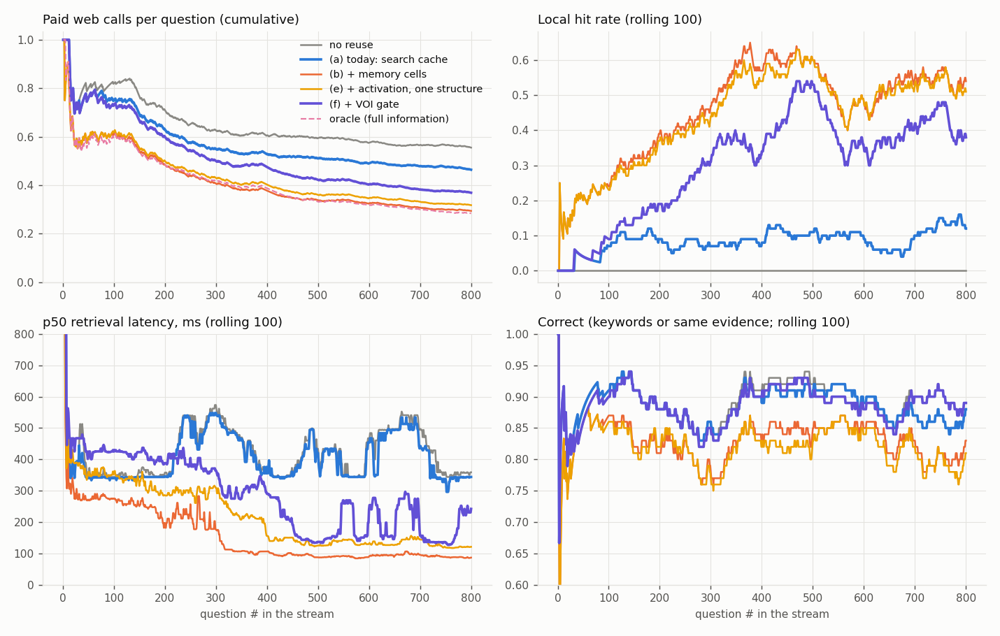

# Keystone: an Arc-keyed answer graph for retrieval that gets cheaper with use

Onset searches while you speak. Every question it answers costs a paid web search (Tavily) unless a free lane
(live-data cards, Wikidata, the local Wikipedia lead index) or the search cache answers it. This write-up is about the
part in between: a local store that absorbs repeat and related demand, so paid web search is spent only on what is
genuinely new or fresh, while accuracy holds.

**Keystone** is that store. One structure replaces three: the search cache (`server/searchcache.py`), the local index,
and the session/user entity memory (`server/memory.py`). The core idea is that **the Arc read-out decides where an
answer is stored**, not the words of the question.

Code: `server/keystone/` (runtime), `eval/keystone/` (data, replays, benchmarks), `tests/test_keystone.py`.
Data and logs: `runs/index/`. Charts: `docs/img/keystone_*.png`.

---

## 1. The problem, measured

A realistic stream of 800 questions from 30 users over about 40 hours (section 4) contains 56 % repeats of an
earlier question family, often in other words, plus many related questions about the same entities. On that
stream, with Wikipedia standing in for the paid lane:

| policy | paid calls / q | local hits | p50 retrieval |
|---|---:|---:|---:|
| no reuse | 0.555 | 0 % | 410 ms |
| today: the semantic search cache | 0.464 | 9 % | 375 ms |

The cache keys on query wording (topic, subject tokens, numbers) and keeps whole result lists for one query, so it
sees only near-identical repeats. Everything else pays again.

## 2. The design

```
 spoken words ──► Arc Tagger read-out ──► typed key (relation, subject)  ─┐ O(1)
                  (intent, entity spans,   answer-equivalence verifier    ├─► candidate local answers
                   types, numbers, act)    question-vector NN            │   ──► VOI gate ──► serve locally (free)
 query vector (EmbeddingGemma 2) ───────►  dense + BM25 over memory cells ┘                 └► or pay for the web
                                                                                                   │
 every retrieval (web / facts / cards) ──► cells + typed edges + value cell + activation  ◄────────┘
```

### A. Memory cells: structure and meaning, not documents (`cells.py`)

A cell holds:

- the EmbeddingGemma 2 vector the reranker already computed (never embedded twice)
- a first-pass copy truncated to 256 Matryoshka dims, used for search
- the full 768-dim float16 vector, used to re-score the 64-row shortlist
- the Arc signature of the question that produced it
- its entities (QIDs when known)
- a **payload**: the answer span, or the 1-2 key sentences for the question (up to 320 characters)
- the source passage, which is optional and the first thing evicted under memory pressure
- fetch time, a TTL from the relation's volatility, and a hit count

Eviction is by value: `(1 + hits) x exp(-age / ttl)`.

**First-pass structure, measured** (`eval/keystone/ann_bench.py`, `runs/index/ann_bench.json`). The corpus is the
11,085 real lead vectors, padded to 100k with jittered copies. Times are p50 on a loaded laptop.

| cells | exact fp32 768 | fp32 256 + rescore | binary 256 + rescore | HNSW (hnswlib) | numpy fp16 768 |
|---:|---:|---:|---:|---:|---:|
| 1k | 0.02 ms | 0.12 ms | 0.32 ms | 0.46 ms (recall 0.96) | 1.6 ms |
| 10k | 2.2 ms | **0.35 ms** | 0.62 ms | 0.93 ms (recall 0.92) | 17 ms |
| 100k | 6.5 ms | 2.3 ms | 9.5 ms | **1.3 ms** (recall 0.91, 20 s build) | 172 ms |

Recall@10 of the two-stage search against exact search: 0.97 at 256 dims, 0.998 at 512, 0.68 at 128, and 0.49 for
binary at 256. int8 matches fp32 recall but is slower in numpy, which has BLAS kernels only for float32 (fp16 is
about 30 times slower).

**Choice:** brute-force float32 at 256 dims with a fp16 rescore. Below about 50k cells it beats HNSW with no build
step and no recall loss. At 100k, HNSW becomes the faster option. At the stream's scale (1.3-1.6k cells after 800
questions) the first pass is a fraction of a millisecond.

**Size:**

| item | size |
|---|---|
| store after 800 questions | 1,622 cells, 4.4 KB per cell in memory (1.1 KB text, 3.3 KB vectors) |
| warm store on disk | 7.5 MB for 1,360 cells |
| learned models (hash, verifier, VOI) | 46 KB in total |

### B. The Arc-keyed index: understanding decides where things are stored (`relkey.py`, `graph.py`)

The partition key is the relation, not the words. "Who founded the company Nvidia", "who started Nvidia" and "who
is the founder of Nvidia" all key to `founded_by(nvidia)`. "When was Nvidia founded" keys to `inception(nvidia)`:
almost the same words, but a different answer.

Arc does not emit a relation label itself, so the relation is read off three Arc signals plus a small cue lexicon:

- **the intent** gates the relation family. A `news_query` or `weather_query` can never key to a stable fact.
- **the entity span and its type** give the subject. Spans split by Arc ("pride", "prejudice") are bridged over
  connectors.
- **the wh- head gives the answer type**, which disambiguates the cue. "founded" + who gives `founded_by`;
  "founded" + when gives `inception`.

Typed number spans are the argument of live relations (`weather_in(chicago, tomorrow)`). Multi-part and comparison
questions get no single key, because the planner splits them. Two-hop questions key to a path:
`born_place(@author_of(pride and prejudice))`.

Every answered question writes a typed edge, `(subject) -[relation]-> (value cell)`, with provenance and a TTL set
by the relation's volatility:

| volatility | example relations | TTL |
|---|---|---|
| stable | founded_by, born, capital_of | 90 days |
| slow | population, CEO, head of state | 30 days |
| live | weather, prices, scores, news | 10 min |

Wikidata facts from the facts lane are written directly as typed triples on QID nodes. Lookup is O(1) on
(subject, relation), and a hop is two lookups.

### C. Streaming key completion (`replay.key_completion`, `eval/keystone/anytime_eval.py`)

While words arrive, the key forms before the question ends. Measured on the workload's keyed questions (378, test
stream):

- **The relation is known 3 words before the end** (p50).
- **The full key resolves only on the last word for 84 % of questions.** English puts the subject last ("who
  founded *nvidia*").

So the typed lookup becomes possible at the last word. It costs microseconds and needs no network and no
embedding, so a key hit is ready the moment the subject is heard.

Dense anytime retrieval over a warm store (80 spoken eval and showcase questions):

- The local top-1 converges before the last word for 69 % of questions, with a p50 lead of 717 ms of speech.
- An incremental BM25 update (term-at-a-time accumulators) costs 11 µs per word.
- A dense re-score costs 181 ms per word on the loaded laptop, almost all of it the query embedding.

Dense search per word is therefore affordable only off the critical path. Sparse search per word and the typed key
are essentially free.

### D. Learned answer equivalence: a hash and a verifier (`ahash.py`, `verify_eq.py`, `eval/keystone/train_ahash.py`)

The goal: decide "this new question has the same answer as one already answered", which is the decision a cache
makes.

**Supervision is free:**

- 669 question families (eval sets, showcase, multipart parts, conversations, and 452 sampled from the 15K
  director queries), each with 3 paraphrases and one **near-miss**: a question about the same entity with a
  different answer. The answer model wrote these in 27 calls (24k tokens in, 164k out).
- Typed templates over lead-index entities, for hard negatives: the same entity with a different relation, and the
  same relation with a different entity.

The split is by family: 70 % train, 30 % test, and the test families are never seen in training. Memory holds one
stored question per answer (plus every near-miss as a distractor). Queries are the other wordings.

| method (held-out families) | precision at ~0.85 coverage | near-miss false accepts at that point |
|---|---:|---:|
| plain embedding NN (cos >= 0.90) | 0.963 @ 0.86 | 19.5 % |
| **NN + Arc verifier (p >= 0.5)** | **0.966 @ 0.84** | **13.5 %** |
| NN + Arc verifier (p >= 0.7) | 0.966 @ 0.75 | 6.5 % (embedding at 0.92: 12.6 % @ 0.79) |
| learned 64-bit hash (Hamming <= 8) | 0.859 @ 0.83 | 4.7 % at r <= 4 (coverage 0.46) |
| typed key rule (exact) | 0.823 @ 0.19 | 5.1 % |


**What this shows:**

- **The learned hash does not beat plain embedding NN.** Top-1 is 0.82 against 0.93. A 64-bit sign code of a linear
  projection throws away too much of the embedding. With 256 bits the codes become too sparse to collide. Without
  the Arc features the hash is slightly better (0.84 top-1), so Arc one-hots inside a linear hash are not the
  answer.
- **The Arc features belong in a verifier**, a logistic model over (cosine, same answer type, relation conflict,
  typed-key conflict, subject overlap, entity and number types, freshness) applied to the NN's top-3 candidates. It
  keeps the embedding's coverage and precision and cuts the near-miss false-accept rate by about 30-50 % at matched
  coverage. The largest weights are `rel_conflict` (-2.1), `key_conflict` (-1.6), `live_same` (+1.7) and subject
  overlap (+1.4). That is exactly the "same words, different answer" case the embedding cannot see.
- **The typed key** is precise on clean template questions (0.955 precision at 0.73 coverage on unseen entities). On
  natural paraphrases it covers only 19 %, because most real questions are not single-relation factoids. Most of its
  remaining errors are label noise: duplicate families with the same answer, which the evaluation already merges
  when the gold answers are identical.

### E. Memory and cache are one structure (`graph.py`, `hook.absorb_memory`, `hook.note_answer`)

- **Nodes** are entities: QIDs when known, canonical names otherwise. Aliases merge "nvidia", "NVIDIA's" and
  "Nvidia Corporation" into one node.
- **Session and user memory are activation on nodes**: per session (half-life 15 min) and per user (half-life 7
  days), with one hop of spreading over co-occurrence. User facts are edges from a "you" node.
- **The cache is the graph's value cells.** A question's value cell carries its question vector (for the
  verifier/NN) and its answer. After the answer model answers, `note_answer` replaces the source sentences with the
  answer span.
- **Ranking:** personalisation is an activation bias on passages, and a follow-up's "it" can resolve to the most
  active node of the kind it asks for.
- **memory.py migrates in behind the flag.** Its entities, Wikidata edges and co-mentions are folded in after every
  answered turn (`absorb_memory`, called from `session._remember` when `INDEX=1`). The old paths stay as the
  fallback: memory.py still resolves references, and the search cache still runs first.

### F. The value-of-information gate (`voi.py`, `eval/keystone/fit_voi.py`)

Each local candidate (key, verifier/NN, hash, dense) gets a calibrated probability that **serving it locally is no
worse than paying**: the local answer is right, or the paid path would have been wrong too. That label is the one
the decision actually needs.

The features are 21 lookup signals: path, top cosine and margin, BM25, subject coverage, Hamming distance, NN
cosine, the verifier's p, edge age as a share of its TTL, activation, whether the subject node is known, whether
the question is live, and store size.

The model is L2 logistic regression, fit on the dev stream's candidates (s2, 1,425 rows over 551 questions) and tested on the test
stream (s1). θ is chosen on the **dev** operating curve as the lowest threshold whose regret is no worse than
today's cache on dev, which gives **θ = 0.93**. θ is then frozen for test.

| | ECE | Brier |
|---|---:|---:|
| dev | 0.042 | 0.118 |
| test | 0.046 | 0.154 |


---

## 3. Integration

- **Local tier** (`router.route`, through `hook.wrap_web`): Keystone sits in front of the paid web lane for every
  speculative and final call, including the facts hedge.
- **Lookup cost:** the typed key comes first and costs µs with no embedding. Only if a cheap posting-list prefilter
  says the store could plausibly answer does it spend one query embedding on the verifier, NN and dense lookups.
  The whole lookup is bounded by `INDEX_TIMEOUT_MS`, and any error falls back to paying as before.
- **Volatile questions** are never served from old passages, only from value cells still inside their 10-minute TTL.
- **Ingest** (`speculator._fire`, one guarded block after `_add_docs`): passages, facts and the value cell, using the
  vectors the reranker just computed. No network, no embedding. The endpoint's query vector is attached to the value
  cell (`note_qvec`).
- **Labels:** locally served docs carry tier `index`, source `Onset index · <original source>`, and the snapshot
  "from your Onset index · as of <fetch time>". The answer pane's lane chip reads **"local index hit · 0 paid ·
  Onset index · as of …"**. The meter counts it as free (`paid=0`), and the search cache never re-caches it.
- **Persistence:** `KEYSTONE_DIR` defaults to the data dir (`DATA_DIR/keystone`, the Mac app's Application Support
  folder, the same pattern as `CACHE_PATH`). It is saved at most every 30 s, and cell ids are remapped on load.
- **Flags:** `INDEX`, `INDEX_SERVE` (0 = shadow), `INDEX_PERSIST`, `INDEX_MAX_CELLS`, `INDEX_FP_DIM`,
  `INDEX_TIMEOUT_MS`, `INDEX_HASH`, `GRAPH_KEY`, `GRAPH_ACT`, `VOI`, `VOI_THETA`, `KEYSTONE_DIR`.
- **The speculator's fire policy is untouched.** The cost agent owns it, and Keystone plugs in through the router and
  one ingest block.

UI shots (1280x720, light and dark, no console errors, no horizontal scroll):
`scratchpad/feature_shots/index/q14_light_minimal.png` and the matching dark, details and q01 shots.

---

## 4. Workload evaluation: the core result

**The stream** (`eval/keystone/make_stream.py`):

- 800 questions from 30 users.
- Popularity is Zipf(1.0) over 669 families.
- Each user has 3 favourite kinds that supply 45 % of their questions.
- Sessions run 2-6 questions. A follow-up family comes next with p 0.6, a near-miss about the same entity with p 0.3.
- 60 % of asks are paraphrases.
- Live families (news, scores, prices, weather, schedules) keep their natural share.
- Arrivals are Poisson, with a 3-minute mean gap.
- Two seeds: s2 is dev (fits the VOI gate), s1 is test (every number below unless marked).

**Today's path, recorded once** (`record_fixture.py`, 844 distinct questions):

- Arc frame, router plan, then `router.route(final=True)`, with the paid lane stood in by live Wikipedia.
- Cards and Wikidata ran for real.
- **Paid = a Tavily-equivalent call** (the web tier).
- No Tavily spend.

**Policies are replayed text-level on a simulated clock** (`replay.py`, about 20 s per policy):

- Network latency is the recorded ms.
- Local latency is the measured lookup compute plus a measured query-embedding p50 (58.7 ms on the loaded laptop).
  The lookup overhead is also charged to every miss.

**Correctness:**

- Answer keywords where they exist: 176 gold and 170 answer-model silver.
- Otherwise, "same evidence": the served passages share a document with what today's path retrieved for any wording
  of the question, or the served value cell was written by the same family.
- **Regret** = the question was answered locally and wrongly where paying would have been right.

| policy (test stream) | paid / q | local | p50 | p90 | correct (keywords) | same evidence | regret |
|---|---:|---:|---:|---:|---:|---:|---:|
| no reuse | 0.555 | 0 % | 410 ms | 914 | 0.673 | 1.000 | 0 % |
| (a) today: search cache | 0.464 | 9 % | 375 ms | 889 | 0.646 | 1.000 | 0.9 % |
| (b) + memory cells, hand gate | 0.294 | 48 % | 77 ms | 727 | 0.607 | 0.937 | 6.8 % |
| (c) + Arc-keyed edges | 0.278 | 50 % | 68 ms | 720 | 0.607 | 0.895 | 9.6 % |
| (d) + equivalence verifier / hash | 0.296 | 48 % | 71 ms | 726 | 0.607 | 0.924 | 7.6 % |
| (e) + activation, one structure | 0.318 | 46 % | 82 ms | 733 | 0.607 | 0.921 | 7.9 % |
| **(f) + VOI gate (θ 0.93 from dev)** | **0.362** | 34 % | **268 ms** | 824 | **0.661** | 0.996 | **0.75 %** |
| oracle (full information) | 0.284 | 50 % | 84 ms | 694 | 0.685 | 1.000 | 0 % |

Dev stream (s2), same order: no reuse 0.482, (a) 0.359, (b) 0.228, (c) 0.239, (d) 0.245, (e) 0.280, **(f) 0.344**
at 0.5 % regret, oracle 0.229. Paid calls at θ 0.93 (test): **(f) uses 22 % fewer than today's cache and 35 % fewer
than no reuse, at the same regret (0.75 % against 0.9 %), with higher keyword accuracy (0.661 against 0.646) and a
lower p50 (268 ms against 375 ms).**



### It gets cheaper with use

Per 100-question window (test stream), Keystone + VOI against today's cache:

| | window | Keystone + VOI | today's cache |
|---|---|---:|---:|
| paid / q | 0-100 | 0.73 | 0.75 |
| | 400-500 | 0.21 | 0.44 |
| | 700-800 | 0.27 | 0.36 |
| p50 | first windows | 345 ms | 340 ms |
| | 600-800 | 125-140 ms | 340-440 ms |

On dev, p50 falls to 62-72 ms in the last 200 questions. Over the last 200 questions Keystone + VOI pays 32 % less
than the cache on test and 13 % less on dev.

### Reading the ablation honestly

- **Adding A-E with a hand gate buys a lot of reuse but loses accuracy.** Regret is 6-10 %, with about 6 points of
  keyword accuracy lost. Most of the loss is dense passages and question-NN reuse on near-misses.
- **Within the hand-gated ablation, B-E do not separate cleanly.** Paid/q stays in 0.28-0.32 and regret in 6-10 %
  across (b)-(e). The typed key path is the most precise local path (0.86 under the hand gate, 0.93 in the oracle),
  but it fires on only 5-8 % of questions.
- **The calibrated VOI gate is what makes the structure usable.** It trades about half of the reuse back for
  accuracy held at today's level, and it is the policy to ship.
- **Headroom is large.** The oracle shows that the same store could answer 50 % of questions locally with zero
  regret, at 0.284 paid/q. The gate realises 57 % of the possible saving on test but only 12 % on dev (where today's
  cache is already strong: 0.359). That gap is the case for phase F.
- **The gate's θ transfers imperfectly between streams.** θ chosen on dev at 0.92 precision gives 0.86 on test. The
  final choice is therefore made by regret on the dev operating curve, which is conservative.

### Real-audio A/B (run_ab, Arc/Flux ear, Wikipedia lane, Onset mode)

See section 7 (filled from `runs/index/ab_*.json`).

---

## 5. Phase F: the director decides over graph state (prototype and design)

The VOI gate is a two-action special case (answer from the graph, or pay). The oracle policy in the replay is the
counterfactual labeller F needs. For every decision point it knows whether each candidate would have been correct,
what paying would have returned, and what each path costs:

- Measured headroom: from 0.362 to 0.284 paid/q at zero regret (test), and from 0.344 to 0.229 (dev).
- Design: add to the director's per-update input:
  - whether the key is resolved
  - `has_edge(subject, relation)`
  - edge age as a share of its TTL
  - the frame entities' activation
  - the verifier's p and the VOI estimate
- Add an action head: answer-from-graph, expand-neighbour, fire-free, fire-paid, wait.
- Labels from replays with full information: reward = correct − λ·paid − μ·latency. Train with cost-sensitive
  imitation, using the director recipe (`pnp-headstart-director`, `recipes/headstart_director`).
- Compare against the hand gate and the VOI gate at matched accuracy.
- Not trained yet. The text-level replay already emits per-word frames, keys and lookup features (`key_completion`),
  so the dataset is a dump of those rows with oracle actions.

## 6. Limitations

- **Wikipedia stands in for Tavily.** Paid latency and answers are Wikipedia's (p50 about 410 ms per routed
  question). Tavily is slower and returns fresher, broader pages, which would raise the value of local reuse for
  latency but change what counts as "same evidence".
- **Correctness is keyword or evidence based.** The evidence label is conservative: a correct local answer from a
  different page counts as wrong. The VOI labels inherit this. No answer-model judging was run on the replay.
- **The stream is synthetic.** It is built from real question pools with Zipf popularity, sessions, paraphrases and
  near-misses, but real repetition rates are unknown. Results are shown for two seeds because they differ.
- **The hash.** The learned 64-bit hash is shipped as a candidate source but measured worse than plain NN. The
  verifier is what works.
- **Relation coverage.** The typed relations cover factoid relations only (37). Open-ended questions rely on the
  verifier/NN and passages.
- **Shared store.** The store is shared by all modes in one process (Race mode: whichever mode searched first helps
  the other).

## 7. Real-audio A/B

_(filled in below when the runs complete)_
