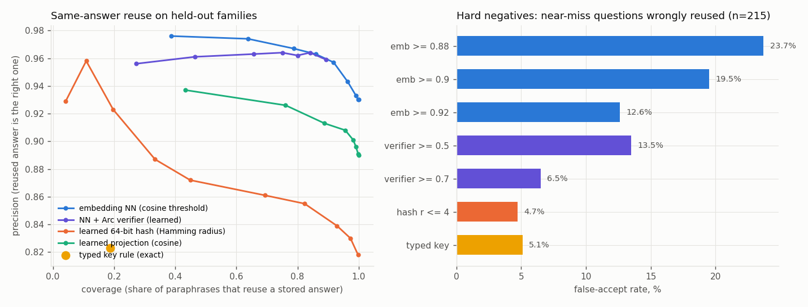
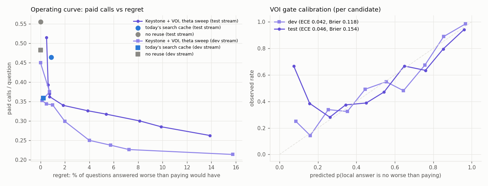
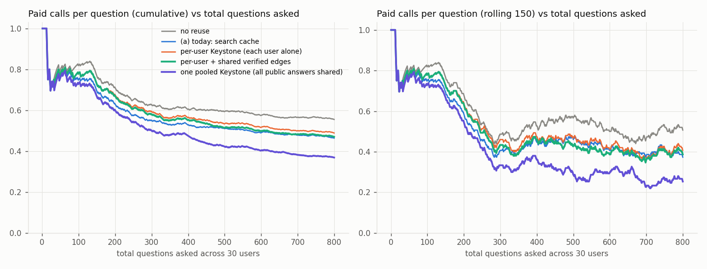
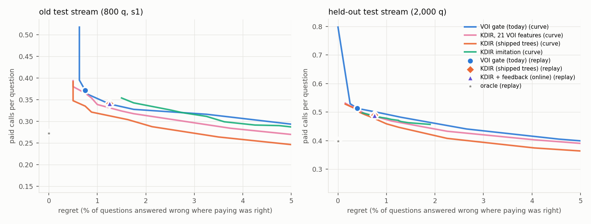
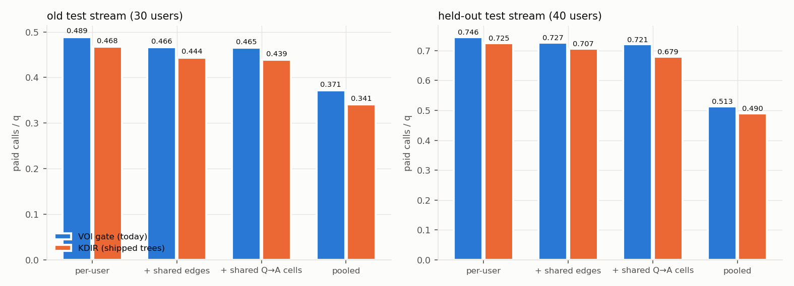

# Keystone: an Arc-keyed answer graph for retrieval that gets cheaper with use

Onset searches while you speak. Every question it answers costs a paid web search (Tavily) unless a free lane
(live-data cards, Wikidata, the local Wikipedia lead index) or the search cache answers it. This write-up is about the
part in between: a local store that absorbs repeat and related demand, so paid web search is spent only on what is
genuinely new or fresh, while accuracy holds.

**Keystone** is that store. One structure replaces three: the search cache (`server/searchcache.py`), the local index,
and the session/user entity memory (`server/memory.py`). The core idea is that **the Arc read-out decides where an
answer is stored**, not the words of the question.

Code: `server/keystone/` (runtime), `eval/keystone/` (data, replays, benchmarks), `tests/test_keystone.py`.
Data and logs: `runs/index/`. Charts: `docs/img/keystone_*.png`.

---

## 1. The problem, measured

A realistic stream of 800 questions from 30 users over about 40 hours (section 4) contains 56 % repeats of an
earlier question family, often in other words, plus many related questions about the same entities. On that
stream, with Wikipedia standing in for the paid lane:

| policy | paid calls / q | local hits | p50 retrieval |
|---|---:|---:|---:|
| no reuse | 0.555 | 0 % | 410 ms |
| today: the semantic search cache | 0.464 | 9 % | 375 ms |

The cache keys on query wording (topic, subject tokens, numbers) and keeps whole result lists for one query, so it
sees only near-identical repeats. Everything else pays again.

## 2. The design

```
 spoken words ──► Arc Tagger read-out ──► typed key (relation, subject)  ─┐ O(1)
                  (intent, entity spans,   answer-equivalence verifier    ├─► candidate local answers
                   types, numbers, act)    question-vector NN            │   ──► VOI gate ──► serve locally (free)
 query vector (EmbeddingGemma 2) ───────►  dense + BM25 over memory cells ┘                 └► or pay for the web
                                                                                                   │
 every retrieval (web / facts / cards) ──► cells + typed edges + value cell + activation  ◄────────┘
```

### A. Memory cells: structure and meaning, not documents (`cells.py`)

A cell holds:

- the EmbeddingGemma 2 vector the reranker already computed (never embedded twice)
- a first-pass copy truncated to 256 Matryoshka dims, used for search
- the full 768-dim float16 vector, used to re-score the 64-row shortlist
- the Arc signature of the question that produced it
- its entities (QIDs when known)
- a **payload**: the answer span, or the 1-2 key sentences for the question (up to 320 characters)
- the source passage, which is optional and the first thing evicted under memory pressure
- fetch time, a TTL from the relation's volatility, and a hit count

Eviction is by value: `(1 + hits) x exp(-age / ttl)`.

**First-pass structure, measured** (`eval/keystone/ann_bench.py`, `runs/index/ann_bench.json`). The corpus is the
11,085 real lead vectors, padded to 100k with jittered copies. Times are p50 on a loaded laptop.

| cells | exact fp32 768 | fp32 256 + rescore | binary 256 + rescore | HNSW (hnswlib) | numpy fp16 768 |
|---:|---:|---:|---:|---:|---:|
| 1k | 0.02 ms | 0.12 ms | 0.32 ms | 0.46 ms (recall 0.96) | 1.6 ms |
| 10k | 2.2 ms | **0.35 ms** | 0.62 ms | 0.93 ms (recall 0.92) | 17 ms |
| 100k | 6.5 ms | 2.3 ms | 9.5 ms | **1.3 ms** (recall 0.91, 20 s build) | 172 ms |

Recall@10 of the two-stage search against exact search: 0.97 at 256 dims, 0.998 at 512, 0.68 at 128, and 0.49 for
binary at 256. int8 matches fp32 recall but is slower in numpy, which has BLAS kernels only for float32 (fp16 is
about 30 times slower).

**Choice:** brute-force float32 at 256 dims with a fp16 rescore. Below about 50k cells it beats HNSW with no build
step and no recall loss. At 100k, HNSW becomes the faster option. At the stream's scale (1.3-1.6k cells after 800
questions) the first pass is a fraction of a millisecond.

**Size:**

| item | size |
|---|---|
| store after 800 questions | 1,622 cells, 4.4 KB per cell in memory (1.1 KB text, 3.3 KB vectors) |
| warm store on disk | 7.5 MB for 1,360 cells |
| learned models (hash, verifier, VOI) | 46 KB in total |

### B. The Arc-keyed index: understanding decides where things are stored (`relkey.py`, `graph.py`)

The partition key is the relation, not the words. "Who founded the company Nvidia", "who started Nvidia" and "who
is the founder of Nvidia" all key to `founded_by(nvidia)`. "When was Nvidia founded" keys to `inception(nvidia)`:
almost the same words, but a different answer.

Arc does not emit a relation label itself, so the relation is read off three Arc signals plus a small cue lexicon:

- **the intent** gates the relation family. A `news_query` or `weather_query` can never key to a stable fact.
- **the entity span and its type** give the subject. Spans split by Arc ("pride", "prejudice") are bridged over
  connectors.
- **the wh- head gives the answer type**, which disambiguates the cue. "founded" + who gives `founded_by`;
  "founded" + when gives `inception`.

Typed number spans are the argument of live relations (`weather_in(chicago, tomorrow)`). Multi-part and comparison
questions get no single key, because the planner splits them. Two-hop questions key to a path:
`born_place(@author_of(pride and prejudice))`.

Every answered question writes a typed edge, `(subject) -[relation]-> (value cell)`, with provenance and a TTL set
by the relation's volatility:

| volatility | example relations | TTL |
|---|---|---|
| stable | founded_by, born, capital_of | 90 days |
| slow | population, CEO, head of state | 30 days |
| live | weather, prices, scores, news | 10 min |

Wikidata facts from the facts lane are written directly as typed triples on QID nodes. Lookup is O(1) on
(subject, relation), and a hop is two lookups.

**1-hop neighbourhoods are cached on use.** After memory's free pre-warm (`knowledge.prefetch`: entity search plus
one SPARQL query for every property the facts lane knows), `absorb_wikidata` writes the subject's whole neighbourhood
as typed edges with value nodes.

**Multi-hop by graph path** (`eval/keystone/hop_eval.py`, the planner's 6 two-hop questions):

- 3 of 6 are answered correctly by graph lookups alone:
  - "where was the author of Pride and Prejudice born": Steventon
  - "when was the director of Jaws born": 1946
  - "population of the capital of Japan": 14.3 M
- Cost: 0.9-1.4 s cold (two free Wikidata fetches) and **3-11 µs warm**.
- The 3 misses:
  - "how old was the founder of X when it was founded" (two cases) needs an age computation, not a relation, and is
    wrongly keyed.
  - Wikidata's CEO statement for Nvidia returns the wrong person.

No paid search is involved in any of them.

### C. Streaming key completion (`replay.key_completion`, `eval/keystone/anytime_eval.py`)

While words arrive, the key forms before the question ends. Measured on the workload's keyed questions (378, test
stream):

- **The relation is known 3 words before the end** (p50).
- **The full key resolves only on the last word for 84 % of questions.** English puts the subject last ("who
  founded *nvidia*").

So the typed lookup becomes possible at the last word. It costs microseconds and needs no network and no
embedding, so a key hit is ready the moment the subject is heard.

Dense anytime retrieval over a warm store (80 spoken eval and showcase questions):

- The local top-1 converges before the last word for 69 % of questions, with a p50 lead of 717 ms of speech.
- An incremental BM25 update (term-at-a-time accumulators) costs 11 µs per word.
- A dense re-score costs 181 ms per word on the loaded laptop, almost all of it the query embedding.

Dense search per word is therefore affordable only off the critical path. Sparse search per word and the typed key
are essentially free.

### D. Learned answer equivalence: a hash and a verifier (`ahash.py`, `verify_eq.py`, `eval/keystone/train_ahash.py`)

The goal: decide "this new question has the same answer as one already answered", which is the decision a cache
makes.

**Supervision is free:**

- 669 question families (eval sets, showcase, multipart parts, conversations, and 452 sampled from the 15K
  director queries), each with 3 paraphrases and one **near-miss**: a question about the same entity with a
  different answer. The answer model wrote these in 27 calls (24k tokens in, 164k out).
- Typed templates over lead-index entities, for hard negatives: the same entity with a different relation, and the
  same relation with a different entity.

The split is by family: 70 % train, 30 % test, and the test families are never seen in training. Memory holds one
stored question per answer (plus every near-miss as a distractor). Queries are the other wordings.

| method (held-out families) | precision at ~0.85 coverage | near-miss false accepts at that point |
|---|---:|---:|
| plain embedding NN (cos >= 0.90) | 0.963 @ 0.86 | 19.5 % |
| **NN + Arc verifier (p >= 0.5)** | **0.966 @ 0.84** | **13.5 %** |
| NN + Arc verifier (p >= 0.7) | 0.966 @ 0.75 | 6.5 % (embedding at 0.92: 12.6 % @ 0.79) |
| learned 64-bit hash (Hamming <= 8) | 0.859 @ 0.83 | 4.7 % at r <= 4 (coverage 0.46) |
| typed key rule (exact) | 0.823 @ 0.19 | 5.1 % |



**What this shows:**

- **The learned hash does not beat plain embedding NN.** Top-1 is 0.82 against 0.93. A 64-bit sign code of a linear
  projection throws away too much of the embedding. With 256 bits the codes become too sparse to collide. Without
  the Arc features the hash is slightly better (0.84 top-1), so Arc one-hots inside a linear hash are not the
  answer.
- **The Arc features belong in a verifier**, a logistic model over (cosine, same answer type, relation conflict,
  typed-key conflict, subject overlap, entity and number types, freshness) applied to the NN's top-3 candidates. It
  keeps the embedding's coverage and precision and cuts the near-miss false-accept rate by about 30-50 % at matched
  coverage. The largest weights are `rel_conflict` (-2.1), `key_conflict` (-1.6), `live_same` (+1.7) and subject
  overlap (+1.4). That is exactly the "same words, different answer" case the embedding cannot see.
- **The typed key** is precise on clean template questions (0.955 precision at 0.73 coverage on unseen entities). On
  natural paraphrases it covers only 19 %, because most real questions are not single-relation factoids. Most of its
  remaining errors are label noise: duplicate families with the same answer, which the evaluation already merges
  when the gold answers are identical.

### E. Memory and cache are one structure (`graph.py`, `hook.absorb_memory`, `hook.note_answer`)

- **Nodes** are entities: QIDs when known, canonical names otherwise. Aliases merge "nvidia", "NVIDIA's" and
  "Nvidia Corporation" into one node.
- **Session and user memory are activation on nodes**: per session (half-life 15 min) and per user (half-life 7
  days), with one hop of spreading over co-occurrence.
- **User facts** can be edges from a "you" node (`Graph.user_fact`), but the live app does not copy them in. The
  server's graph is shared by every connected browser, so user facts stay in memory.py's per-browser store. They can
  never enter the cross-user store (section 3b).
- **The cache is the graph's value cells.** A question's value cell carries its question vector (for the
  verifier/NN) and its answer. After the answer model answers, `note_answer` replaces the source sentences with the
  answer span.
- **Ranking:** personalisation is an activation bias on passages, and a follow-up's "it" can resolve to the most
  active node of the kind it asks for.
- **memory.py migrates in behind the flag.** Its entities, Wikidata edges and co-mentions are folded in after every
  answered turn (`absorb_memory`, called from `session._remember` when `INDEX=1`). The old paths stay as the
  fallback: memory.py still resolves references, and the search cache still runs first.

### F. The value-of-information gate (`voi.py`, `eval/keystone/fit_voi.py`)

Each local candidate (key, verifier/NN, hash, dense) gets a calibrated probability that **serving it locally is no
worse than paying**: the local answer is right, or the paid path would have been wrong too. That label is the one
the decision actually needs.

The features are 21 lookup signals: path, top cosine and margin, BM25, subject coverage, Hamming distance, NN
cosine, the verifier's p, edge age as a share of its TTL, activation, whether the subject node is known, whether
the question is live, and store size.

The model is L2 logistic regression, fit on the dev stream's candidates (s2, 1,426 rows) and tested on the test
stream (s1). θ is chosen on the **dev** operating curve as the lowest threshold whose regret is no worse than
today's cache on dev, which gives **θ = 0.95**. θ is then frozen for test.

| | ECE | Brier |
|---|---:|---:|
| dev | 0.044 | 0.119 |
| test | 0.043 | 0.148 |



---

## 3. Integration

- **Local tier** (`router.route`, through `hook.wrap_web`): Keystone sits in front of the paid web lane for every
  speculative and final call, including the facts hedge.
- **Speculative calls** (mid-sentence) try only the typed key and never embed. The endpoint lookup reuses the
  speculator's own query embedding (`share_qvec`).
- **Lookup cost:** the typed key comes first and costs µs with no embedding. Only if a cheap posting-list prefilter
  says the store could plausibly answer does it spend one query embedding on the verifier, NN and dense lookups.
  The whole lookup is bounded by `INDEX_TIMEOUT_MS`, and any error falls back to paying as before.
- **Volatile questions** are never served from old passages, only from value cells still inside their 10-minute TTL.
- **Ingest** (`speculator._fire`, one guarded block after `_add_docs`): passages, facts and the value cell, using the
  vectors the reranker just computed. No network, no embedding. The endpoint's query vector is attached to the value
  cell (`note_qvec`).
- **Labels:** locally served docs carry tier `index`, source `Onset index · <original source>`, and the snapshot
  "from your Onset index · as of <fetch time>". The answer pane's lane chip reads **"local index hit · 0 paid ·
  Onset index · as of …"**. The meter counts it as free (`paid=0`), and the search cache never re-caches it.
- **Persistence:** `KEYSTONE_DIR` defaults to the data dir (`DATA_DIR/keystone`, the Mac app's Application Support
  folder, the same pattern as `CACHE_PATH`). It is saved at most every 30 s, and cell ids are remapped on load.
- **Flags:** `INDEX` (default **1**), `INDEX_SERVE` (0 = shadow), `INDEX_PERSIST`, `INDEX_SAVE_S`,
  `INDEX_MAX_CELLS`, `INDEX_FP_DIM`, `INDEX_TIMEOUT_MS`, `INDEX_SPEC_EMBED`, `INDEX_HASH`, `INDEX_SHARED`
  (default 1), `KEYSTONE_SHARED`, `GRAPH_KEY`, `GRAPH_ACT`, `VOI`, `VOI_THETA`, `KEYSTONE_DIR`.
- **The speculator's fire policy is untouched.** The cost agent owns it, and Keystone plugs in through the router and
  one ingest block.

UI shots (1280x720, light and dark, no console errors, no horizontal scroll):
`scratchpad/feature_shots/index/q14_light_minimal.png` and the matching dark, details and q01 shots.

### 3b. The shared Keystone: verified public knowledge across users (`shared.py`)

**Lookup order:**

1. The user's **personal overlay**: their own Keystone (cells, edges, activation).
2. The **shared store**: other users' verified typed edges.
3. Otherwise the VOI gate decides whether to pay for the web.

The shared store holds only what passes an explicit allowlist at its API boundary (`shared.admit`):

- **Allowed:** typed edges (subject) -[relation]-> value on a public relation (`relkey.RELATIONS`), whose provenance
  is **Wikidata** or an answer that `server/verify.py` found in at least one cited source (status `supported` or
  `agree`).
- **Refused:** the "you" node and user facts, memory and activation, unverified or disagreeing answers, personal
  subjects ("my …"), values that look personal (emails, phone numbers, "you …"), and live relations with a long TTL.
- **Each edge carries:** provenance, verify status, source and URL, as-of time, the relation's TTL, and a
  contribution count. No user id is stored.

`tests/test_keystone.py::test_a_user_fact_can_never_reach_the_shared_store` drives a learned user fact ("I live in
Denver") through memory absorption, ingest and a verified answer that mentions it, then asserts that the shared
store holds only Wikidata or verified public edges with no "you" subject and no home/diet/allergy relation.

**Interface:** `SharedKeystone` has three methods: `get`, `publish` and `stats`. `SQLiteShared` implements it on a
local file (`KEYSTONE_SHARED`, in the data dir), so a remote store can implement the same three later.

**Labels:** answers from the shared store read **"verified by Onset users · as of …"**. The source line reads "Onset
users · <original source>" and the lane chip reads "shared index hit · 0 paid".

**The network effect, measured** (`replay.py --policies fresh,a,fu,fs,f`, test stream, 30 users, 800 questions):

| store | paid / q | local | correct (keywords) | regret |
|---|---:|---:|---:|---:|
| no reuse | 0.555 | 0 % | 0.673 | 0 % |
| today's search cache (process-wide) | 0.464 | 9 % | 0.646 | 0.9 % |
| per-user Keystone (each user alone) | 0.489 | 9 % | 0.669 | 0.13 % |
| **per-user + shared verified edges** | **0.470** | 15 % | 0.669 | 0.25 % |
| one pooled Keystone (every public answer and passage shared) | 0.369 | 33 % | 0.658 | 0.75 % |

The shared store answered 50 questions at **96 % accuracy**. It holds 135 edges (127 verified answers and 8 Wikidata
facts) from 267 contributions, and refused 4.



**What this shows:**

- **A store per user loses** to today's process-wide cache. A user asks about 27 questions here, too few to repeat
  much.
- **Pooling only verified typed edges recovers 4 %.** Typed edges cover only the 5-8 % of questions that are
  single-relation factoids.
- **The network effect is real, but it lives in the pooled store's other contents:** verified answers to
  non-factoid questions (value cells keyed by answer equivalence) and public passages. Fully pooled, cost falls to
  0.369 paid/q and keeps falling with total usage.
- **The next step is a wider allowlist:** admit verified question→answer value cells (public questions only, the
  answer verified against a cited source, keyed by the Arc verifier) and public web passages. Personal facts and
  activation stay out.

### 3c. Which Arc read-out fields Keystone uses, and how (for the Arc-usage audit)

| Arc field (server/frame.py) | Where | How |
|---|---|---|
| `intent` (discourse.intent.*; coarse intent.*) | `relkey.relation_of`, `ahash.arc_features`, `verify_eq` | Gates the relation family (weather / stock / news / currency → live relations, never a stable fact). One-hot feature of the answer-equivalence verifier and the hash. |
| entity spans + types (`slots`, `ent_types`, `phrases`) | `relkey._span_subject`, `core.write` / `lookup`, `graph` | The **subject** of the typed key. Split spans are bridged over connectors ("pride" + "prejudice"). Graph nodes and their kind. Activation targets. The verifier's `ent_same`. |
| typed number / time spans (`date`, `time`, `money`, …; `num_types`) | `relkey.key_of` (arg), `arc_features`, `verify_eq` | The argument of live relations (`weather_in(chicago, tomorrow)`, a month makes it climate). The verifier's `num_same` (same question, other number = other answer). |
| freshness (`when` / `when_text`, topic via `searchcache.ttl_class`, narrow family) | `hook.is_live`, `core.lookup`, TTLs | Live questions are never served from old passages, only from value cells inside their 10-minute TTL. The live flag is a VOI and verifier feature. |
| answer type | `relkey.answer_type` | **Not an Arc read-out.** Derived from the wh- head (who / when / where / how tall / how many). It disambiguates the relation cue ("founded" + who vs + when) and is the verifier's `ans_same`. |
| dialogue act (`acts`: question, command_request, …) | `hook.addressed`, `arc_features` | Only questions and requests write into the store (statements and opinions don't). A hash/verifier feature. |
| addressedness (`directed`, discourse.assistant.device_directed) | `hook.addressed` | Speech not addressed to the assistant (p < 0.3: side talk, TV) never writes a cell, an edge or activation. |
| correction spans (`dropped`, `cue`) | `relkey.key_of_frame` (via `router.repaired_text`), `hook.live_slots` | The key is built from the question as meant. The corrected-away entity's span is removed, so **an abandoned subject never gets a node, an edge, a cell or activation** (test: "when was Google founded, no wait, Apple" writes Apple only). |
| memory resolution (`inline`, `carried`) | `hook.q_of`, `relkey.key_of_frame` | A follow-up's "it" is keyed by the resolved entity ("when was it founded" → `inception(nvidia)`). |

**Not used yet:**

- per-word fused confidence (`wconf`): a natural next gate is to not write from low-confidence ASR.
- affect, speaker, content mode.

---

## 4. Workload evaluation: the core result

**The stream** (`eval/keystone/make_stream.py`):

- 800 questions from 30 users.
- Popularity is Zipf(1.0) over 669 families.
- Each user has 3 favourite kinds that supply 45 % of their questions.
- Sessions run 2-6 questions. A follow-up family comes next with p 0.6, a near-miss about the same entity with p 0.3.
- 60 % of asks are paraphrases.
- Live families (news, scores, prices, weather, schedules) keep their natural share.
- Arrivals are Poisson, with a 3-minute mean gap.
- Two seeds: s2 is dev (fits the VOI gate), s1 is test (every number below unless marked).

**Today's path, recorded once** (`record_fixture.py`, 844 distinct questions):

- Arc frame, router plan, then `router.route(final=True)`, with the paid lane stood in by live Wikipedia.
- Cards and Wikidata ran for real.
- **Paid = a Tavily-equivalent call** (the web tier).
- No Tavily spend.

**Policies are replayed text-level on a simulated clock** (`replay.py`, about 20 s per policy):

- Network latency is the recorded ms.
- Local latency is the measured lookup compute plus a measured query-embedding p50 (58.7 ms on the loaded laptop).
  The lookup overhead is also charged to every miss.

**Correctness:**

- Answer keywords where they exist: 176 gold and 170 answer-model silver.
- Otherwise, "same evidence": the served passages share a document with what today's path retrieved for any wording
  of the question, or the served value cell was written by the same family.
- **Regret** = the question was answered locally and wrongly where paying would have been right.

| policy (test stream) | paid / q | local | p50 | p90 | correct (keywords) | same evidence | regret |
|---|---:|---:|---:|---:|---:|---:|---:|
| no reuse | 0.555 | 0 % | 410 ms | 914 | 0.673 | 1.000 | 0 % |
| (a) today: search cache | 0.464 | 9 % | 375 ms | 889 | 0.646 | 1.000 | 0.9 % |
| (b) + memory cells, hand gate | 0.294 | 48 % | 107 ms | 744 | 0.607 | 0.937 | 6.8 % |
| (c) + Arc-keyed edges | 0.297 | 48 % | 100 ms | 747 | 0.607 | 0.928 | 7.4 % |
| (d) + equivalence verifier / hash | 0.296 | 48 % | 155 ms | 778 | 0.607 | 0.926 | 7.5 % |
| (e) + activation, one structure | 0.318 | 46 % | 171 ms | 790 | 0.607 | 0.923 | 7.8 % |
| **(f) + VOI gate (θ 0.95 from dev)** | **0.369** | 33 % | **310 ms** | 868 | **0.658** | 0.996 | **0.75 %** |
| oracle (full information) | 0.284 | 50 % | 225 ms | 783 | 0.685 | 1.000 | 0 % |

Local latencies include the lookup compute measured during this run. The laptop was at load average 50-60 from
other agents' benchmarks; an earlier run at lower load measured (f) at 268 ms.

Dev stream (s2), same order: no reuse 0.482, (a) 0.359, (b) 0.228, (c) 0.239, (d) 0.245, (e) 0.280, **(f) 0.350**
at 0.25 % regret (the same as the cache), oracle 0.229.

**On test, (f) uses 20 % fewer paid calls than today's cache and 34 % fewer than no reuse**, at the same regret
(0.75 % against 0.9 %), with higher keyword accuracy (0.658 against 0.646) and a lower p50 (310 ms against 375 ms).


### It gets cheaper with use

Per 100-question window (test stream), Keystone + VOI against today's cache:

| | window | Keystone + VOI | today's cache |
|---|---|---:|---:|
| paid / q | 0-100 | 0.73 | 0.75 |
| | 400-500 | 0.21 | 0.44 |
| | 700-800 | 0.28 | 0.36 |
| p50 | first windows | 430 ms | 340 ms |
| | 400-800 | 137-242 ms | 344-454 ms |

On dev, p50 falls to 222-248 ms in the last 200 questions, against 381-580 ms for the cache. Over the last 200
questions Keystone + VOI pays 31 % less than the cache on test (0.265 against 0.385) and 7 % less on dev (0.30
against 0.325).

### Reading the ablation honestly

- **Adding A-E with a hand gate buys a lot of reuse but loses accuracy.** Regret is 6-10 %, with about 6 points of
  keyword accuracy lost. Most of the loss is dense passages and question-NN reuse on near-misses.
- **Within the hand-gated ablation, B-E do not separate cleanly.** Paid/q stays in 0.28-0.32 and regret in 6-10 %
  across (b)-(e). The typed key path is the most precise local path (0.86 under the hand gate, 0.93 in the oracle),
  but it fires on only 5-8 % of questions.
- **The calibrated VOI gate is what makes the structure usable.** It trades about half of the reuse back for
  accuracy held at today's level, and it is the policy to ship.
- **Headroom is large.** The oracle shows that the same store could answer 50 % of questions locally with zero
  regret, at 0.284 paid/q. The gate realises 53 % of the possible saving on test but only 7 % on dev (where today's
  cache is already strong: 0.359). That gap is the case for phase F.
- **The gate's θ transfers imperfectly between streams.** θ chosen on dev at 0.92 precision gives 0.86 on test. The
  final choice is therefore made by regret on the dev operating curve, which is conservative.

### Real-audio A/B

See section 7.

---

## 5. The Keystone director v1 (`KDIR=1`, default **off**)

The VOI gate (§2F) is a two-action rule: serve the best local candidate when a logistic p over 21 lookup features
clears θ = 0.95, else pay. The director replaces it with a learned policy over four actions and over the graph's
state. Code: `server/keystone/kdir.py` (runtime), `server/keystone/hook.py` (`kdir_decide`, `free_first`,
`recheck_cell`), `eval/keystone/kdir_*.py`, `tests/test_kdir.py`. Results: `runs/index/kdir_results.json`.

**Headline.** On dev the director pays less than the VOI gate at no worse regret (s2 0.350 → 0.335 at 0.25 %;
new dev 0.479 → 0.426 at 0.05 % against 0.10 %). On the two test streams it also pays less (s1 0.371 → 0.341,
held-out test 0.513 → 0.490) **but at higher regret** (0.75 % → 1.25 % and 0.40 % → 0.75 %), and it closes 36 % / 24 %
of the gap to the local oracle, not half. The real-audio pair was slower (+281 ms paired median). **It ships behind
`KDIR=1`, default off.** What did transfer: the bigger workload, the counterfactual labels and the operating curves
show where the gate's headroom is (dense passages; §5.4), and the tree policy's operating curve lies on or below the VOI
gate's on both test streams.

### 5.1 A bigger, real workload (`kdir_stream.py`, `kdir_record.py`, `kdir_director_feats.py`)

- **Pools (10,232 root questions, no audio, no personal data):** the 669 rich families (paraphrases, near-misses,
  gold / silver keywords), 9,006 director route-labelled spoken questions (`$ARC_HANDOFF/data/from_director/
  route_labels.jsonl`; PII lines, commands and "not a request" dropped; follow-up chains kept from
  `runs/director_queries`), and 557 addressed open-mic questions (context-dependent follow-ups left out).
- **Three disjoint streams, held-out users AND held-out question families** (split by the root family's hash):
  train 7,000 questions / 120 users, dev 2,000 / 40, test 2,000 / 40; 11,000 in all. Zipf(0.9) popularity, 3
  favourite kinds per user, sessions of 2-6 with follow-ups and near-misses, 60 % paraphrases where a family has them,
  the per-user arrival rate of the 800-question stream. Repeat share 0.59-0.64 (the old streams: 0.56). Live
  questions 15-18 %.
- **Paraphrases** for the 1,404 families likely to repeat (the Zipf head of each split, plus their follow-ups) came from
  the answer model, 25 per call: **49,397 input + 297,690 output tokens**, cached in `runs/index/kdir_labels.json`.
  No other Anthropic calls were made.
- **Counterfactual labels for every action** (5,626 distinct questions, all recorded once with a response cache):
  today's path (Arc frame → router plan → `router.route`, Keystone off), the paid lane alone for the 788 questions
  today's path answers for free, and the free lanes alone for the 4,838 web-tier questions (the planned card /
  Wikidata lane, the Wikipedia summary of the frame's entity; the offline leads index is searched at replay time from
  the question vector). WEB_BACKEND=wikipedia stands in for Tavily (no Tavily spend). 17,968 doc and 18,525 question
  EmbeddingGemma vectors.
- **Arc + director signals** for the 15,136 director questions that were voiced: the shipped director (Mamba-3 int8)
  replayed over each question's real Flux update stream (`kdir_dirfeats.npz`: eot / fire / draft / addressed / route
  per update + Flux and fused word confidence).

### 5.2 Actions, cost and regret

| action | paid | regret counted when |
|---|---|---|
| `pay` (today's path: the router's free lane when it planned one, else the paid lane) | 1 for a web plan | never (the reference) |
| `local` (best candidate: key / hash / question NN / dense / shared) | 0 | the local answer is wrong and paying was right |
| `local_rc` (local + a background re-check on the free lanes) | 0 | as `local`, **unless the free lanes return a strong, right answer** (then it is a *corrected* answer, counted separately) |
| `free` (free lanes first, pay only if weak; never for live / fresh questions) | 0 if strong, else 1 | the strong free answer is wrong and paying was right |
| `wait` (per word, §5.5) | 0 | the prefix answer differs from the final one |

Expected cost per question, J = paid + R · P(regret) + C · P(corrected) + ε · re-checks + 0.5 · latency (s); R is the
operating knob (a wrong answer priced in paid calls), C = 1, ε = 0.02. The oracle with all four actions:
s1 **0.273** (local-only oracle 0.287), held-out test **0.399** (0.416). The free lanes add only 1.5-2 % on top of
local reuse: on web-tier, non-live questions they are strong 13 % of the time and right only about half of those.

### 5.3 The learned policy (`kdir.py`, `kdir_train.py`, `kdir_eval.py --part train|pick`)

- **Inputs (80):** (a) the VOI gate's 21 lookup features; (b) graph state: key known / hop, any edge for (subject,
  relation) even if stale, subject known, store size, the candidate cell's trust (feedback), hits, age over its
  learned TTL, how many lookup paths agree, fact / card source, volatility class; question-pair features (the stored
  question vs this one: token Jaccard, entity coverage, a different number, the same wh- word, how many top cells
  share one question, title coverage); (c) Arc / director: intent (8 fine intents) and its p, question / command acts,
  typed spans (people / places / orgs, numbers), the router's plan lane and confidence, follow-up, the leads index's
  top cosine and margin, and the director's eot / fire / addressed / route outputs + Flux / fused confidence (when the
  question was voiced).
- **Models:** p_ok (per candidate: serving it is no worse than paying), p_catch (the free lanes answer right),
  p_free_strong and p_free_ok. Gradient-boosted trees (xgboost, depth 4, ≤150 trees), Platt-calibrated on dev
  (p_ok ECE 0.011, Brier 0.061), exported to flat arrays and evaluated in numpy. Training rows: the train stream logged
  under the VOI gate with exploration, then DAgger round 1 under the round-0 policy (31,954 candidate rows).
- **Operating point:** the cheapest R whose **real dev replays** keep regret no worse than today on both dev streams
  (s2: today's search cache, 0.25 %; new dev: the shipped VOI gate, 0.10 %, because the cache's regret there is 0).
  Picking R offline on VOI-logged decisions was optimistic (a policy changes its own store) and was replaced.
- **Imitation** of the oracle's action (multiclass trees) was worse than the expected-cost rule at every margin:
  regret 0.65-1.9 % at matched cost.
- **The director's signals did not help:** with them (3b) dev 0.339 / 0.434, without (3c) 0.335 / 0.426. 3c ships;
  the director is off by default in the app anyway, so its outputs are usually missing at runtime.
- **Size and speed:** `kdir_model.json` 225 KB (shipped model); decision p50 1.1-1.9 ms, p99 3.4 ms in the replay on a
  loaded laptop (pure-Python tree walk; the VOI gate is 0.01 ms).

### 5.4 Ablation, measured by replay (paid / q · regret · keyword accuracy · p50)

Each step adds to the one above. Dev and test are never used for training; R and θ are chosen on dev only.

| step | s2 (old dev) | new dev | **s1 (old test)** | **held-out test** |
|---|---|---|---|---|
| no reuse | 0.482 · 0 · 0.571 · 574 | 0.861 · 0 · 0.646 · 540 | 0.555 · 0 · 0.673 · 410 | 0.887 · 0 · 0.846 · 547 |
| today: VOI gate θ 0.95 | 0.350 · 0.25 % · 0.589 · 276 | 0.479 · 0.10 % · 0.658 · 201 | **0.371 · 0.75 %** · 0.658 · 261 | **0.513 · 0.40 %** · 0.712 · 222 |
| 1. VOI refit on the 7k train stream | 0.364 · 0.13 % | 0.521 · 0.05 % | 0.355 · 0.63 % · 0.658 · 263 | 0.522 · 0.40 % · 0.712 · 231 |
| 2a. trees on the same 21 features, pay / local | 0.357 · 0.25 % | 0.463 · 0.05 % | 0.364 · 0.75 % · 0.658 · 273 | 0.509 · 0.50 % · 0.712 · 216 |
| 2b. + re-check action | 0.357 · 0.25 % | 0.463 · 0.05 % | 0.364 · 0.75 % | 0.508 · 0.50 % |
| 2c. + free-first action | 0.357 · 0.25 % | 0.463 · 0.05 % | 0.364 · 0.75 % | 0.508 · 0.50 % |
| 3a. + graph state | 0.350 · 0.13 % | 0.445 · 0.10 % | 0.355 · 1.00 % | 0.505 · 0.55 % |
| 3b. + Arc + director signals | 0.339 · 0.25 % | 0.434 · 0.05 % | 0.344 · 1.25 % | 0.492 · 0.65 % |
| **3c. + Arc, no director (shipped)** | **0.335 · 0.25 %** · 0.593 · 273 | **0.426 · 0.05 %** · 0.658 · 64 | 0.341 · 1.25 % · 0.658 · 253 | 0.490 · 0.75 % · 0.712 · 186 |
| 3d. imitation instead of expected cost | 0.338 · 0.63 % | 0.448 · 0.65 % | 0.346 · 1.87 % | 0.489 · 1.00 % |
| 4. + feedback: trust + online refit / 500 q | 0.335 · 0.25 % | 0.425 · 0.05 % | 0.341 · 1.25 % | 0.486 · 0.75 % · 0.712 · 163 |
| 5. + learned TTLs (store expiry) | 0.339 · 0.13 % | 0.426 · 0.05 % | 0.341 · 1.25 % | 0.488 · 0.75 % · 0.712 · 180 |
| oracle, local only | 0.230 | 0.366 | 0.287 | 0.416 |
| oracle, all actions | 0.212 | 0.351 | 0.273 | 0.399 |

Keyword accuracy (176 gold + 170 silver on s1/s2; fewer on the new streams) is unchanged in every row except
imitation. The "corrected" share (wrong, then fixed by the re-check) is ≤ 0.05 % everywhere.



**Reading it honestly:**
- **Against the bar** (close half the gap at regret no worse than today): s1 closes 36 % (0.371 → 0.341 of
  0.084) at 1.25 % regret against 0.75 %; held-out test closes 24 % (0.513 → 0.490 of 0.097) at 0.75 % against
  0.40 %. **Not met.** On dev, where R was chosen, regret held and the new-dev gap closed 47 % (s2: 13 %).
- **The dev → test transfer is the problem, not the curve.** On the test streams' operating curves (offline, on
  VOI-logged decisions) the shipped trees lie on or below the VOI gate's curve: at the VOI gate's own regret they pay
  ~0.03 less per question on s1 and about the same on the held-out test. The chosen R simply lands at a higher-regret point on test than on dev. Regret is a
  count of 4-25 questions per stream here, so the operating point is noisy; a larger dev set or a regret margin
  (choosing R for 0.5 × today's dev regret) would be the next thing to try.
- **The new actions barely matter on this workload.** Re-check serves 1-2 % of questions and catches almost
  nothing, because the free lanes are rarely strong-and-right for the questions the local store is unsure about;
  free-first is chosen ≤ 0.2 %. The oracle itself gains only 0.014-0.018 paid/q from them.
- **Where the headroom is:** per-path AUC of p_ok on s2: key 0.96, hash 0.94, question NN 0.90, **dense passages
  0.75**. Dense candidates are 144 of the 281 "good but not served" candidates. The silver label for passages
  (shares a document with today's path) is also the noisiest label.

### 5.5 Waiting one more word (`kdir_wait.py`, exploratory)

On the director-pool questions with a typed-key candidate (train 94, dev 69, test 33 sequences), a per-update
classifier over the director's outputs + Flux / fused confidence + the graph state of the words heard so far (key
complete, prefix lookup returns the final cell, subject has an edge): GBDT and a 16-unit GRU on top of the frozen
director (1,841 parameters). Committing at p ≥ 0.95 answers 75-79 % of these questions before Flux's end of turn
(median lead 0.76 s on test, 2.5 s on dev) but at 92-94 % precision, against 100 % for the end-of-turn key path on
dev. Not shipped; too few sequences to set a threshold.

### 5.6 Feedback loop and learned volatility

- **Feedback** (`kdir.feedback`): a re-check confirmation raises a cell's trust (+1), a catch or a spoken correction
  lowers it (−2), a cited-source verification +0.5; bounded ±4. The replay simulates spoken corrections of wrong local
  answers at 30 %. Trust is a model input, and the p_ok trees are refit every 500 questions on the train rows + the
  stream's feedback rows (oracle labels are never used). Measured: test 0.490 → 0.486, p50 186 → 163 ms; per 500-question
  window (test, VOI / KDIR / KDIR + feedback): 0.646 / 0.622 / 0.622, 0.490 / 0.466 / 0.466, 0.480 / 0.460 / 0.450,
  0.436 / 0.412 / 0.406. Only 11 feedback rows arrive on the 2,000-question test stream, because the re-check is
  rarely chosen; the loop works mechanically but has little to learn from here.
- **Per-domain trust** (the Tavily lead's suggestion): the same feedback also accumulates trust per source domain,
  overall and per question family (`kdir.trusted_domains` → include / exclude lists for a parameterised paid search).
  It is computed and tested, not yet sent to the paid lane (lanes.py is outside this branch's scope); Tavily's
  per-result score / published date / response time are not in these records because the bulk ran on the Wikipedia
  lane.
- **Learned TTLs** (`fit_ttl.py` → `server/keystone/ttl_model.json`): Wikidata statement histories (start / end
  qualifiers, censored-exponential change rate; point-in-time series for quantities), TTL = time to a 5 % chance of
  change, clamped to [5 min, 365 d]. Stable relations → 365 d (was 90); slow ones: population 99 d, area 83 d,
  manufacturer 157 d, HQ 277 d, CEO / head of state ~350-365 d (was 30 d: open-ended statements that ended in reality
  but not in Wikidata bias the rate down). Live: 75 card / fresh questions re-asked at +15 / +60 min: weather 46 % /
  62 % changed → 5 min, prices 15 % / 38 % → 6 min (was 10 min); news keeps 10 min (the Wikipedia stand-in cannot see
  news change). The replays span 3-4 days, so the slower TTLs never bind, and stale answers inside a TTL are counted
  as right by the family-origin label: **the replay cannot measure the effect of TTLs** (step 5 is ±0.002).
  `KDIR_TTL` (default = `KDIR`) switches them on.

### 5.7 The wider shared store and the network effect (`shared.SharedCells`, `kdir_eval.py --part network`)

Verified question → answer cells may now enter the cross-user store (`KDIR_SHARED_CELLS=1`, default off), behind an
allowlist at the boundary (`shared.admit_cell`): the answer passed `verify.check` against a cited source
(supported / agree) with a public URL; the question has no first / second person, phone, email or street address;
no local-moment or private-corpus source; live questions only with their minutes-long TTL. No user id is stored. The
privacy test (`test_a_user_fact_never_reaches_shared_cells`) drives "where do I live" through memory, ingest and a
verified answer and asserts it never enters.

| store (paid / q · regret) | s1: VOI | s1: KDIR | test: VOI | test: KDIR |
|---|---|---|---|---|
| per-user only | 0.489 · 0.13 % | 0.468 · 0.63 % | 0.746 · 0.10 % | 0.725 · 0.40 % |
| + shared verified edges | 0.466 · 0.25 % | 0.444 · 0.75 % | 0.727 · 0.35 % | 0.707 · 0.65 % |
| **+ shared Q→A cells** | 0.465 · 0.25 % | **0.439 · 0.37 %** | 0.721 · 0.35 % | **0.679 · 0.70 %** |
| one pooled store | 0.371 · 0.75 % | 0.341 · 1.25 % | 0.513 · 0.40 % | 0.490 · 0.75 % |

The shared cells admitted 97-101 cells on s1 and ~455 on test (409-587 refused, mostly answers verify could not find
in their source). They add 0.5-4 points on top of shared edges, more with the director (which can weigh a shared
cell's verifier p and agreement) than with the VOI gate. Most of the pooled store's advantage is still unverified
passages and value cells that the allowlist rightly keeps out.



### 5.8 Real-audio A/B (`eval/keystone/ab_kdir.sh`)

58-question set, Onset mode, the `.env` ear, `COST_MODE=parity`, Wikipedia web lane, the warm store
(`runs/index/warm_store`, copied fresh per run), `runs/.run_ab.lock` held per timed run only. One pair (VOI then KDIR)
before the memory budget and the user's quiet window stopped heavy jobs; the showcase pair was not run.

| 58 set | ready p50 | ready p90 | correct | paid / q | answers from the index |
|---|---:|---:|---:|---:|---:|
| VOI gate (KDIR=0) | 1,939 ms | 3,824 | 56/58 | 0.17 | 2 |
| KDIR=1 | 2,255 ms | 3,357 | 57/58 | 0.19 | 1 |

Paired per question, KDIR − VOI: **median +281 ms**, mean +137 ms. The machine was swapping (20 GB of swap in use,
p50s ~500 ms above earlier rounds), so this one pair is weak evidence, but it is not "no slower". No Tavily credits
were spent (the 150-credit allowance was kept unused).

**Ship decision: `KDIR=1` stays default off.** It does not meet the bar on test (regret) or in the real-audio pair
(latency).

**Flags:** `KDIR` (0), `KDIR_FREE` (1), `KDIR_RECHECK` (1), `KDIR_R` (unset = the dev-chosen 15),
`KDIR_FREE_TIMEOUT_S` (1.2), `KDIR_SHARED_CELLS` (0), `KDIR_TTL` (= KDIR). Any error, a missing model or a model
trained on another feature set falls back to the VOI gate.

**Reproduce:** `kdir_stream.py` → `kdir_record.py` (network, once) → `kdir_director_feats.py` → `fit_ttl.py [--live]`
→ `kdir_eval.py --part train`, `--part pick`, `--part ablation`, `--part network`, `--part curves` →
`kdir_wait.py` → `plots_kdir.py`. Set `OMP_NUM_THREADS=1` on a busy machine (multi-threaded BLAS made the replay 20×
slower under load).

## 6. Limitations

- **Wikipedia stands in for Tavily.** Paid latency and answers are Wikipedia's (p50 about 410 ms per routed
  question). Tavily is slower and returns fresher, broader pages, which would raise the value of local reuse for
  latency but change what counts as "same evidence".
- **Correctness is keyword or evidence based.** The evidence label is conservative: a correct local answer from a
  different page counts as wrong. The VOI labels inherit this. No answer-model judging was run on the replay.
- **The stream is synthetic.** It is built from real question pools with Zipf popularity, sessions, paraphrases and
  near-misses, but real repetition rates are unknown. Results are shown for two seeds because they differ.
- **The hash.** The learned 64-bit hash is shipped as a candidate source but measured worse than plain NN. The
  verifier is what works.
- **Relation coverage.** The typed relations cover factoid relations only (37). Open-ended questions rely on the
  verifier/NN and passages.
- **The personal overlay is process-wide.** The Mac app and the demo are single-user, so the Race mode's two
  sessions share it (whichever mode searched first helps the other). A multi-user server would key the overlay by
  client id, as memory.py's store already does. User facts are never copied into it.

## 7. Real-audio A/B (`eval/keystone/ab_index.sh`, `ab_summary.py`, `runs/index/ab_*.json`)

**Setup:** `run_ab.py`, Onset (headstart) mode, the configured ear (Deepgram Flux + Arc), Wikipedia as the web lane,
real time. Three conditions:

- **off:** INDEX=0.
- **cold:** INDEX=1 with an empty store at every question (fresh sessions).
- **warm:** INDEX=1 with the store the workload replay built (`runs/index/warm_store`: 1,360 cells, the "other users
  asked related things before" case), kept across the run.

Each timed run took the shared benchmark lock.

**Fixes found by the first warm run** (warm against off: +45 ms paired median):

- The endpoint lookup embedded the question a second time on the single-worker query pool. It now awaits the
  speculator's own embedding (`share_qvec`).
- Persistence ran on the event loop (about 75 ms every 30 s with 1.4k cells). It is now a 17 ms snapshot, with the
  write on a background thread, every 60 s.

Round 3 runs on the fixed code, with off and warm back to back.

| 58-question set (38 web + 20 local moments) | n | ready p50 | ready p90 | correct | paid / q | answered from the index |
|---|---:|---:|---:|---:|---:|---:|
| off (round 1) | 58 | 1375 ms | 1812 | 58/58 | 0.50 | 0 |
| cold (round 1) | 58 | 1284 ms | 2008 | 56/58 | 0.53 | 0 |
| warm (round 1, before the fixes) | 58 | 1443 ms | 2024 | 58/58 | 0.47 | 6 |
| off (round 2) | 58 | 1471 ms | 2074 | 58/58 | 0.57 | 0 |
| warm (round 2, shared embedding) | 58 | 1477 ms | 2019 | 58/58 | 0.45 | 8 |
| off (round 3) | 58 | 1626 ms | 2113 | 56/58 | 0.64 | 0 |
| **warm (round 3, both fixes)** | 58 | **1522 ms** | 1950 | **58/58** | **0.36** | 9 |

| showcase (29 scored) | n | ready p50 | ready p90 | correct | paid / q | answered from the index |
|---|---:|---:|---:|---:|---:|---:|
| off | 29 | 1482 ms | 3449 | 0.933 | 0.86 | 0 |
| cold | 29 | 960 ms | 1929 | 0.933 | 0.79 | 2 (in-question reuse) |
| warm (round 1) | 29 | 1328 ms | 1742 | 0.933 | 0.79 | 3 |

**Paired per-question ready-time differences** (median / mean):

| comparison | median | mean |
|---|---:|---:|
| cold - off | +9 ms | -39 ms |
| warm - off, round 1 | +46 ms | +73 ms |
| warm - off, round 2 | +44 ms | +59 ms |
| **warm - off, round 3** | **-100 ms** | **-116 ms** |

**The two cold-run misses (56/58) are not caused by the index.** Both are local-moments questions (local04 "what
did the commentator say about Lonzo Ball", local11 "what did the judge say about where in the chair the gun was"):

- They take the `local` route, which never reaches the router or the index. Their `tiers` are empty.
- They retrieved exactly the same three moments as the off run, through the same path (draft reuse).
- The answer model worded them differently ("Ball nailing a three" against the keyword "triple"; the "cushion"
  detail left out).
- Re-running both questions 3 times each: off 6/6, cold 6/6 (`runs/index/ab_miss_*.json`).
- Off round 3 shows the same kind of variance on two other questions (q07, q31) with the index off.

Two changes came out of the investigation regardless:

- Local-moment docs are no longer copied into Keystone (they have their own index).
- `run_ab`'s cold mode never persists to the data dir.

**What the A/B says.** On fresh sessions, the index costs nothing measurable: cold against off is +9 ms paired
median, with the same sources and the same paths.

Warm, after the two fixes, it saves paid calls on the real-audio set:

- **0.64 → 0.36 paid/q (round 3)**, 0.57 → 0.45 (round 2), and 0.50 → 0.47 (round 1).
- 6-9 questions were answered from the index, mostly the facts lane's hedge: a slow Wikidata lookup used to fire a
  paid web call, and now the typed edge answers it.
- p50 is 100 ms better paired, and 58/58 correct.

The off runs themselves vary by ±150 ms p50 between rounds (the machine is shared with other agents' benchmarks),
so only paired, back-to-back comparisons are quoted as evidence.

**Default: INDEX=1** (persistent, in the app's data dir). Shadow mode is `INDEX_SERVE=0`, off is `INDEX=0`.

## 8. Answer calibration: one confidence per answer (`server/calibrate.py`, branch feat/calib)

Every answer now carries `conf` (0..1, "answers like this were right about X% of the time"), a band (high / medium /
low) and one plain reason ("2 sources agree", "heard 'Kress' unclearly", "sources don't say"). The metric has
`conf`, `conf_band`, `conf_reason`, `conf_feats` (the model inputs, so live runs can be refitted) and `conf_pre` (the
same model before the answer model runs). The UI shows it as a badge under the answer (`web/confidence.js`).

**Both scores are kept.** Tavily's per-result relevance `score` was parsed (`lanes._parse`) but the final ranking is
EmbeddingGemma cosine over the pool (`speculator.rank`), so the Tavily number never reached anything. The `sources`
event now carries both per doc: `src_score` (Tavily's, only for Tavily docs) and `rerank_score` (the cosine; `score`
stays for older clients). The calibrator reads `src_top` / `src_margin`. `CALIB_FUSE=<w>` adds `w × src_score` to the
cosine in the ranking (default 0: not measured, see below). `CALIB_PUBDATE=1` sends Tavily `include_published_date`
(no extra credit) and the newest source's age becomes `src_age_d`; a live-data question answered from sources more
than a week old gets the doubt "sources may be out of date". Default off: untested against the real API.

**Features** (`calibrate.features`; missing values are imputed with the training mean, so a signal a lane cannot give
adds nothing either way):

| group | features |
|---|---|
| sources | Tavily score of the top result and its margin over the rest; newest source age; rerank cosine top-1, top-1 − top-2, mean of top 3; number of sources; how many of the top 3 name the question's subject |
| router / facts | lane (card / facts / web), the plan's own conf, a Wikidata fact or live card among the sources (reason "from Wikidata" / "live data") |
| Keystone | an index hit, shared ("verified by Onset users") vs personal, age of the cell |
| Arc | confidence of the least-sure decisive word (min of ear and fused, `Frame.sconf`; the word goes into the reason), self-correction, follow-up / carried subject, hesitation fillers, a retrieval-in-the-loop rewrite, intent and its probability, length |
| answer (post only) | verify status (agree / supported / partial / unverified / disagree) and the share of claims found, a "the sources don't say" answer, extractive fallback, citations, length |

**Model.** Logistic regression on standardized features, then isotonic regression fitted on 5-fold out-of-fold
outputs of the train split (`eval/calib_fit.py` → `server/calib_model.json`; the scoring reuses
`server/confidence.py`'s linear / sigmoid core). A gradient-boosted model was tried in place of the logistic one: same
AUC, worse Brier (0.172 vs 0.161 post), so the small model ships.

**Labels** (`eval/calib_data.py`, text path, WEB_BACKEND=wikipedia, Keystone off, no Tavily spend): 647 answered
questions = 210 Keystone question families with an `expect` (canon + 2 paraphrases; 158 from the 58 set / showcase
gold, 465 with LLM-written keywords) + 24 Arc-value corrections. Each is routed as today (router.route(final=True);
the kdir fixture's recorded docs reused read-only when it has the exact text, 232 of them), ranked by EmbeddingGemma,
answered by the real answer model (647 calls, est. $0.13), verified, and scored with run_ab's keyword scorer. Test split =
30 % of families by family id (paraphrases never straddle): 186 answers, 76.9 % right. The kdir counterfactual dataset
has no gold answers, so it supplies docs only, not labels.

**Reliability on the held-out test split (186 answers):**

| score | ECE | Brier | AUC |
|---|---|---|---|
| raw rerank cosine (top-1) as a probability | 0.046 | 0.179 | 0.55 |
| raw router plan conf | 0.335 | 0.274 | 0.63 |
| calibrated, before the answer (`conf_pre`) | 0.027 | 0.174 | 0.60 |
| **calibrated, after the answer (`conf`, the badge)** | **0.034** | **0.161** | **0.72** |

Reliability bins of the badge's `conf` (mean conf → accuracy): 0.5-0.6: 0.53 → 0.47 (17); 0.6-0.7: 0.63 → 0.61 (18);
0.7-0.8: 0.75 → 0.71 (28); 0.8-0.9: 0.84 → 0.81 (97); 0.9-1.0: 0.91 → 0.96 (26). Bands (conf ≥ 0.8 high, < 0.6 low):
high 123 answers 84.6 % right, medium 46 at 67.4 %, low 17 at 47.1 %.

Reading it honestly:
- The cosine happens to sit near the base accuracy (low ECE by coincidence) but cannot tell right from wrong (AUC
  0.55). The router's conf is badly calibrated (its 0.9+ bin is right 44 % of the time).
- Before the answer the signals are weak (AUC 0.60): conf_pre never goes below 0.7 on this set, so it has no low band.
  What separates right from wrong is mostly the answer itself (a "sources don't say" answer, verify's checks).
- The labels are keyword matches. LLM-written keywords are noisy (e.g. "short" vs "shortened" for staccato), so on
  the gold-keyword subset (52 test answers, 94 % right) the model is under-confident (mean conf 0.83).
- Text path: no ASR, so `key_conf` (the "heard 'X' unclearly" signal) is missing in training and gets no weight yet.
  Live runs now log `conf_feats`; refit with `eval/calib_fit.py --rows runs/calib/rows.jsonl <live rows>`.
- Wikipedia results have no relevance score, so `src_top` / `src_margin` / `src_age_d` are not fitted either. Fitting
  them needs real Tavily responses: about 650 searches (the same questions) ≈ 650-1,300 credits. Not spent.
- These are Wikipedia-lane numbers. WEB_BACKEND=tavily also changes endpoint timings and draft budgets
  (server/config.py `_TAVILY`), so the demo's Tavily settings will not match exactly.

**Router use (CALIB_ROUTE, default OFF).** At the endpoint, before the answer model: high → answer now; medium →
one free lookup first (the question's Wikidata fact + the local leads article, the lanes recheck.py uses), the new docs
join the top 5 by cosine; low → one more paid search (`calibrate.alt_query`: the subject alone, else the whole
question; never a query already searched) when the parity budget (`final_max`) allows, else the free lookup. Each is
capped at CALIB_ROUTE_WAIT_S (1.2 s); any failure answers with the ranking it had. "Wait for the end of the turn" at a
soft endpoint is not built: the text path cannot measure it.

Measured on the test split (`eval/calib_route_eval.py`, re-answering when the top 5 changed):

| policy | accuracy | paid calls / q | extra answer-model calls | extra lookup p50 |
|---|---|---|---|---|
| off | 76.9 % | 0.83 | 0 | 0 |
| on (bands 0.6 / 0.8): 122 / 186 medium → free lookup | 76.3 % (0 fixed, 1 broken) | 0.83 | 5 | 274 ms |
| on, every non-high answer → one more search | 77.4 % (4 fixed, 3 broken) | 1.48 | 96 | 337 ms |

The free lookup rarely changes the top 5 (5 of 122) and the extra search buys one net answer for +0.65 paid calls / q,
so CALIB_ROUTE stays off. The pre-answer signals are the bottleneck; better ones (real ASR confidence, Tavily scores)
would have to come first.

**Live (real audio, 58 set, Onset arm, parity, Wikipedia lane, `runs/calib/ab_q58_on_r2.json`):** 58 / 58 right, every
answer carries a conf; conf 0.8+ on 46 (all right), 0.6-0.8 on 12 (all right), none low; Brier 0.037. The model is
under-confident here: 10 of the 12 middle answers are local-moment questions (the text-path labels have none) and
the "heard 'three' unclearly" reason fired on local01 (Flux heard "three" at < 0.85). Cost: the model adds 0.04 ms
before and 0.08 ms after the answer (1,000-call microbenchmark). A paired replay (CALIB on vs off, r1) read +136 ms
paired median, which that cost cannot explain: the on arm ran first, on a machine shared with three other agents'
replays; the second pair was stopped when the user started live-testing (load, memory). **Defaults: CALIB=1,
CALIB_BADGE=1** (compute + badge; the answer path is unchanged), CALIB_ROUTE=0, CALIB_FUSE=0, CALIB_PUBDATE=0.

## 9. Telem: a second paid web backend, failover, page reads, monitors (`server/telem.py`, branch feat/telem)

Telem (telem.ai) is one API in front of many search engines (brave, exa, tavily, perplexity, you, tinyfish, ...) and
page readers. Onset uses it in four places, every one behind a flag and OFF by default:

| Flag | What it does |
|---|---|
| `WEB_BACKEND=telem` | The paid web lane searches through Telem instead of Tavily (`lanes._live`). |
| `TELEM_MODE=family\|auto\|fixed` | Which engines: Onset's router family picks them (`family`, `FAMILY_PROVIDERS`), Telem's auto-routing picks them (`auto`), or `TELEM_PROVIDERS` always (`fixed`). |
| `WEB_FAILOVER=telem` (or `tavily`) | A final question whose primary paid backend fails (or whose breaker is open) tries the other one, then Wikipedia, then the recorded cache. Speculative searches never pay a second backend. |
| `VERIFY_FETCH=telem` | The verify escalation reads the cited page with Telem `/v1/fetch` instead of Tavily `/extract` (`server/pagefetch.py`, one contract for both). |
| `TELEM_MONITORS=1` | "Keep me posted" on a live question asked again and again, backed by a Telem monitor (`server/telem_monitor.py`). |

Family to engines (a hypothesis until `eval/telem_ab.py` measures it): live families (news, sports, finance, weather)
go to brave (dated results and a news vertical); reference, definition, health and how-to go to exa (search by
meaning); places and travel go to brave (locations vertical). tinyfish, which costs nothing, runs with each of them, so
a URL two engines return is marked as agreeing.

What each source carries: Telem returns one result list per engine. Onset merges them by URL. Each Doc keeps the engine
that ranked it best, its rank there, that engine's latency, and how many engines found it (`meta.agree`).
`Doc.score` is reciprocal rank summed over engines and divided by the number of engines that answered. It is a
cross-engine signal, not Tavily's relevance score, so the calibrator does not read it as `src_score`; that feature
falls back to its training mean, as it does on Wikipedia.

Cost works the same way for both backends. Telem charges each engine's own list price with no markup and returns no $
figure at tier `default`. Onset therefore prices each engine run that succeeded from Telem's price table (failed runs
are free) and labels the result est. (exa's price is "what exa reports", so it is estimated at its $0.005 list price).
That $ is converted to Tavily-credit units for the session Ledger and the meter, so budgets, the final reserve and the
on-screen $ treat both backends alike. `TELEM_PROCESS_USD` (default $3) is a hard cap for each process.

Observability: the first Telem call of a conversation returns a `session_id`, and every later call sends it back, so
the Telem console shows the conversation as one session. Each question's metric carries `telem_trace` (the session id
and the interaction id of each call), `telem_engines` (engine, ok, ms, result count) and `telem_routing` (what
auto-routing chose). Telem documents no per-trace URL, so the details show these ids and no link.

Measured: nothing yet. Every number in this section will come from `eval/telem_ab.py` (30 questions: entities, news
and sports from 2026-11, travel and how-to, multi-part; Tavily via Telem vs auto vs family; hit@5, p50/p90, est. $ per
question, failure rate), run once the Telem key is in `.env`, with a $3 cap.
